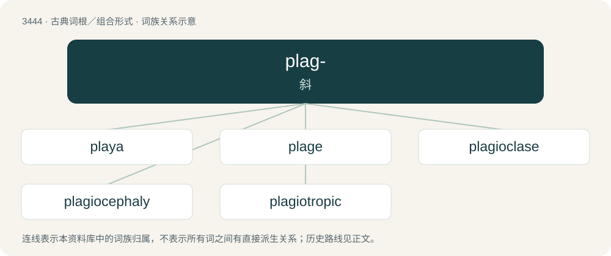

# 3522 · plag- — 斜

[总目录](../00_总目录_按常用程度.md)

**类型**：古典词根／组合形式　｜　**来源语言**：古希腊语

## 核心含义与来源

- 核心含义：斜
- 英文含义：oblique
- 词形：plag-

**来源词形**：πλάγος (plágos), πλάγιος (plágios), πλαγιότης

## 词族图

## 单词速览（常用到不常用）

| 单词 | 音标 | 释义 |
|---|---|---|
| [playa](#w-1) | 美 /ˈplaɪə/ | n. 干盐湖, 河滩, 海边休养地 |
| [plage](#w-2) | /pleɪd͡ʒ/ | n. 海滨, 谱斑 |
| [plagioclase](#w-3) | 英 /ˈpleɪ.d͡ʒɪ.əˌkleɪz/；美 /ˈpleɪ.d͡ʒi.əˌkleɪs/ | n. 斜长岩；\[化\] 斜长石 |
| [plagiocephaly](#w-4) | /,pleidʒiəˈsefəli/ | n. \[医\]斜头( 畸形) |
| [plagiotropic](#w-5) | /pleidʒiəˈtrɔpik/ | a. \[植\]斜向(性)的 |

## 逐词详解

### 1. playa

**词性**：名词　｜　**音标**：美 /ˈplaɪə/

**中文释义**：n. 干盐湖, 河滩, 海边休养地

**英文义项**：A level area which habitually fills with water that evaporates entirely.

**词源与演化**：

Borrowed from Spanish playa (“beach”). Doublet of plage.

### 2. plage

**词性**：名词　｜　**音标**：/pleɪd͡ʒ/

**中文释义**：n. 海滨, 谱斑

**英文义项**：A region viewed in the context of its climate; a clime or zone. / A bright region in the chromosphere of the Sun.

**词源与演化**：

From French plage, from Late Latin plagia, from Latin plaga (“region”) (cognate with English flake). Doublet of playa.

### 3. plagioclase

**词性**：名词　｜　**音标**：英 /ˈpleɪ.d͡ʒɪ.əˌkleɪz/；美 /ˈpleɪ.d͡ʒi.əˌkleɪs/

**中文释义**：n. 斜长岩；\[化\] 斜长石

**英文义项**：Any of a group of aluminum silicate feldspathic minerals ranging in their ratio of calcium to sodium.

**构词拆分**：plagio- + -clase

**词源与演化**：

From plagio- + -clase, after German Plagioklas.

### 4. plagiocephaly

**词性**：名词　｜　**音标**：/,pleidʒiəˈsefəli/

**中文释义**：n. \[医\]斜头( 畸形)

**英文义项**：A congenital condition where the skull suffers an oblique malformation.

**构词拆分**：plagio- + -cephaly

**词源与演化**：

From plagio- + -cephaly.

### 5. plagiotropic

**词性**：形容词　｜　**音标**：/pleidʒiəˈtrɔpik/

**中文释义**：a. \[植\]斜向(性)的

**英文义项**：Growing at an oblique or almost horizontal angle

**构词拆分**：plagio- + -tropic

**词源与演化**：

From plagio- + -tropic.
