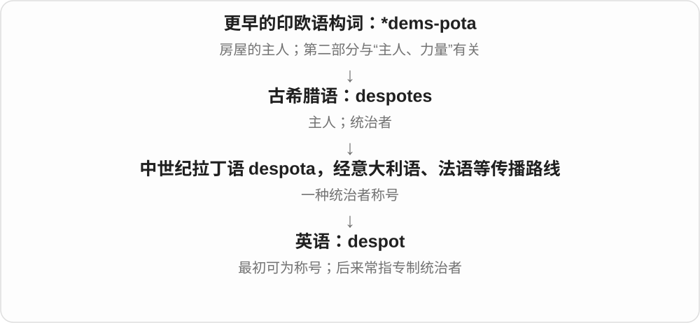
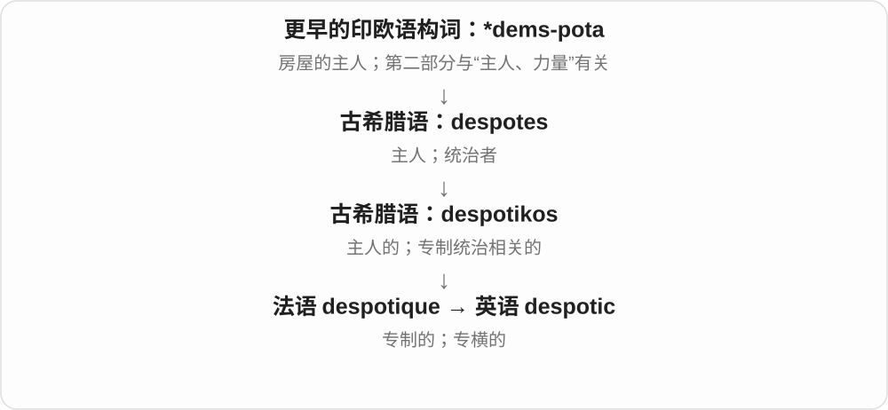
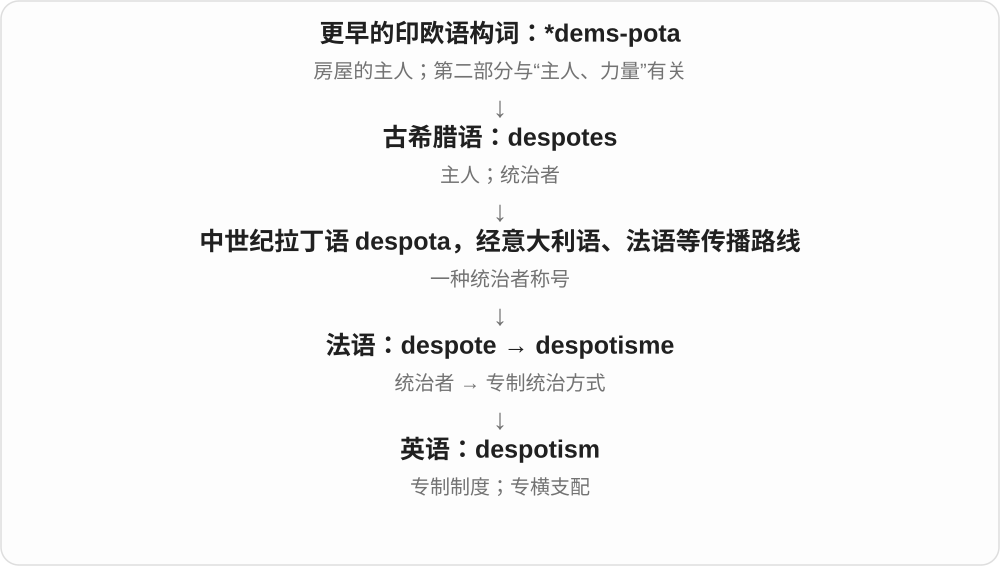

# 3631 · despot- — 主人；统治者；专制权力

[逐词精讲目录](../00_逐词精讲目录.md) · [总目录](../00_总目录_按常用程度.md)

## 核心词根与来源

despot 指人，despotic 描述作风或权力性质，despotism 讨论统治方式。历史上的头衔未必一开始就像今天这样强烈贬义；现代一般要听出专横的批评。

**从一家之主的权力画面，走向不受约束、独自说了算的统治者。**

希腊 despotes → 中世纪拉丁 despota／法语 despote 等 → despot；希腊 despotikos 经法语成 despotic；法语 despotisme → despotism。

- **掌权的人**：despot
- **作风与性质**：despotic
- **统治方式**：despotism

## 词形与演化规律

despot 重读开头，despotic 重读第二节；despotism 中间弱读。despotic 与 despotism 分别有自己的法语借入线，不全是英语名词加后缀。

## 单词速览（常用到不常用）

| 单词 | 音标 | 核心意思 |
|---|---|---|
| [despot](#w-1) | 英 /ˈdespɒt/；美 /ˈdespət/ | 专制统治者；独断专行的人；历史称号 |
| [despotic](#w-2) | 英 /deˈspɒtɪk/；美 /deˈspɑːtɪk/ | 专制的；专横的 |
| [despotism](#w-3) | /ˈdespətɪzəm/ | 专制统治；专横作风 |

## 逐词讲解

### 1. despot — 专制统治者；独断专行的人；历史称号

**音标**：英 /ˈdespɒt/；美 /ˈdespət/

**先抓住这个画面**

despot 像把整个国家都当成自己家、什么都要自己说了算的主人；这是理解现代贬义的画面。

**怎么拆**

来自希腊 despotes“主人”，经中世纪拉丁及意大利语、法语等路线进入英语。其第二部分与 potis 有更早的同源关系，不是由拉丁 potent 派生。

**怎么变成今天的意思**

历史上它可作为统治者的称号，并非一出现就是骂人；现代通常指权力不受约束、独断的统治者，也可讽刺家中或办公室里的专横人物。

**常见搭配与例句**

an absolute despot；rule like a despot；a local despot。

> The despot allowed no public criticism of his rule.

这个专制统治者不容许公众批评他的统治。

> The biography explains that “despot” was also a historical title.

传记解释说，despot 过去也曾是一种正式称号。

**别混淆**

potentate 突出显赫权势；despot 在现代通常还带专制、任意支配他人的负面评价。

### 2. despotic — 专制的；专横的

**音标**：英 /deˈspɒtɪk/；美 /deˈspɑːtɪk/

**先抓住这个画面**

despotic 描写“我的话就是规则，你没有商量余地”的统治或做派。

**怎么拆**

由法语 despotique 借入，追溯希腊 despotikos，与 despotes“主人”相连；现代可联系 despot + -ic，历史并非英语名词先进入法语。

**怎么变成今天的意思**

despotic rule 可以谈国家统治；a despotic manager 可以比喻公司里不容异议的管理者。常带明确批评色彩。

**常见搭配与例句**

despotic rule；a despotic regime；despotic behavior。

> The reforms ended decades of despotic rule.

改革结束了数十年的专制统治。

> His despotic manner drove experienced staff away.

他专横的作风把有经验的员工逼走了。

**别混淆**

strict 只是严格，仍可按公平规则办事；despotic 更强调权力任性、别人没有发言空间。

### 3. despotism — 专制统治；专横作风

**音标**：/ˈdespətɪzəm/

**先抓住这个画面**

despotism 把“所有人都得服从一个不受约束的权力中心”作为一种制度或做法来讲。

**怎么拆**

来自法语 despotisme，由 despote 加 -isme 构成；现代英语可对应 despot + -ism，但法语名词有独立借入路线。

**怎么变成今天的意思**

可以指政治制度，也可比喻家庭、组织里的专横控制。区别于只指一个人的 despot，它把焦点放在统治方式和长期状态上。

**常见搭配与例句**

absolute despotism；resist despotism；benevolent despotism。

> The essay argues against despotism in every form.

这篇文章反对各种形式的专制。

> Even the club’s small decisions were shaped by his petty despotism.

连俱乐部里的小事也受他那套小霸王作风支配。

**别混淆**

despot 是人；despotic 是性质；despotism 是制度、作风或现象。benevolent despotism 中即使强调善意，仍是权力高度集中的概念。

## 这一组要分清什么

严格 strict 可以依规则行事；despotic 强调独断和支配。monarchy 是君主制名称，不直接等同 despotism。

## 串起来练习

分别用三个词描述人物、作风、制度；解释 enlightened despot 为什么并没有取消绝对权力这一层含义。
