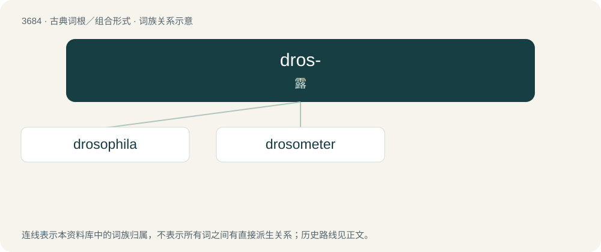

# 3735 · dros- — 露

[总目录](../00_总目录_按常用程度.md)

**类型**：古典词根／组合形式　｜　**来源语言**：古希腊语

## 核心含义与来源

- 核心含义：露
- 英文含义：dew
- 词形：dros-

**来源词形**：δρόσος, δρόσου (drósos, drósou)

## 词族图

## 单词速览（常用到不常用）

| 单词 | 音标 | 释义 |
|---|---|---|
| [drosophila](#w-1) | 美 /dɹoʊˈsɑfələ/ | n. 果蝇；\[医\] 果蝇属 |
| [drosometer](#w-2) | /dɹə(ʊ)ˈsɒmɪtə(ɹ)/ | n. 露量计 |

## 逐词详解

### 1. drosophila

**词性**：名词　｜　**音标**：美 /dɹoʊˈsɑfələ/

**中文释义**：n. 果蝇；\[医\] 果蝇属

**英文义项**：Any fruit fly of the genus Drosophila

**词源与演化**：

From taxonomic name Drosophila.

### 2. drosometer

**词性**：名词　｜　**音标**：/dɹə(ʊ)ˈsɒmɪtə(ɹ)/

**中文释义**：n. 露量计

**英文义项**：A device for measuring the amount of dew on a surface.

**词源与演化**：

From Ancient Greek δρόσος (drósos, “dew”) + -meter.
