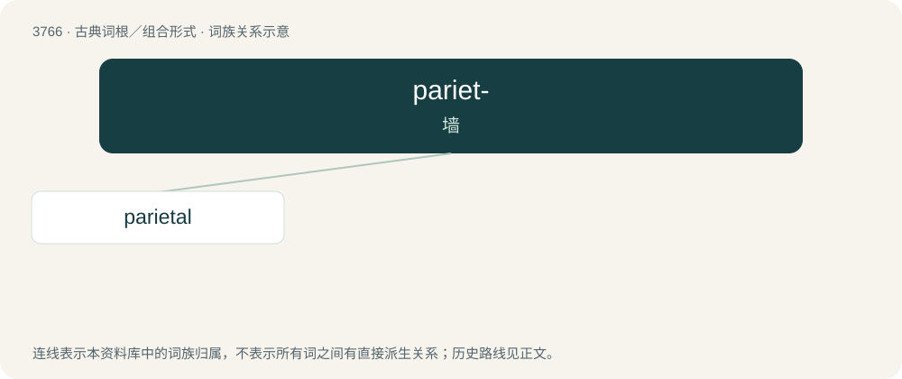

# 3802 · pariet- — 墙

[总目录](../00_总目录_按常用程度.md)

**类型**：古典词根／组合形式　｜　**来源语言**：拉丁语

## 核心含义与来源

- 核心含义：墙
- 英文含义：wall
- 词形：pariet-

**来源词形**：paries, parietis

## 词族图

## 单词速览（常用到不常用）

| 单词 | 音标 | 释义 |
|---|---|---|
| [parietal](#w-1) | /pəˈɹaɪ.ə.təl/ | a. 周壁的, 体壁的, 顶骨的, 侧膜的；n. 顶骨 |

## 逐词详解

### 1. parietal

**词性**：形容词　｜　**音标**：/pəˈɹaɪ.ə.təl/

**中文释义**：a. 周壁的, 体壁的, 顶骨的, 侧膜的；n. 顶骨

**英文义项**：Of or relating to the wall of a body part, organ or cavity. / Of or relating to the parietal bones.

**词源与演化**：

From Latin parietālis, from pariēs (“wall”).

**例句**：

> Hydrochloric acid is secreted by the parietal cells of the gastric glands, located on the wall of the fundus of the stomach.

该用例对应义项：Of or relating to the wall of a body part, organ or cavity.
