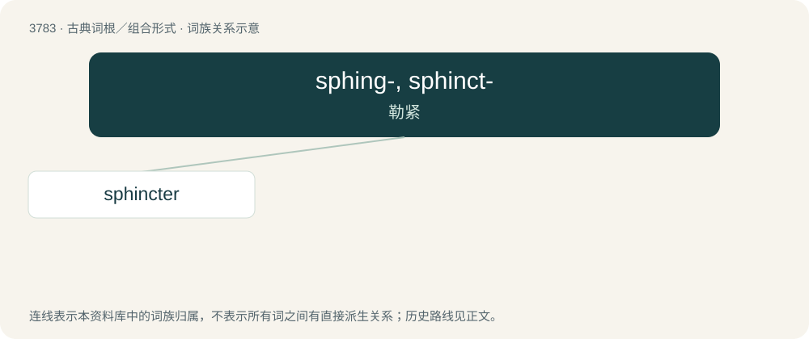

# 3816 · sphing-, sphinct- — 勒紧

[总目录](../00_总目录_按常用程度.md)

**类型**：古典词根／组合形式　｜　**来源语言**：古希腊语

## 核心含义与来源

- 核心含义：勒紧
- 英文含义：strangle
- 词形：sphing-, sphinct-

**来源词形**：σφίγγειν (sphíngein), Σφίγξ sphings, σφιγκτήρ

## 词族图

## 单词速览（常用到不常用）

| 单词 | 音标 | 释义 |
|---|---|---|
| [sphincter](#w-1) | 美 /ˈsfɪŋk.tɚ/ | n. 括约肌；\[医\] 括约肌 |

## 逐词详解

### 1. sphincter

**词性**：名词　｜　**音标**：美 /ˈsfɪŋk.tɚ/

**中文释义**：n. 括约肌；\[医\] 括约肌

**英文义项**：A ringlike band of muscle that surrounds a bodily opening (such as the anus or the openings of the stomach), constricting and relaxing as required for normal physiological functioning.

**词源与演化**：

Learned borrowing from Late Latin sphinctēr (“the muscle of the anus”), from Ancient Greek σφῐγκτήρ (sphĭnktḗr, “lace, band; contractile muscle”), ultimately of Pre-Greek origin. Possibly related to sphinx (“the strangler”).

**用法示例／搭配（非完整句）**：

> the iris sphincter in the eye

该用例对应义项：A ringlike band of muscle that surrounds a bodily opening (such as the anus or the openings of the stomach), constricting and relaxing as required for normal physiological functioning.
