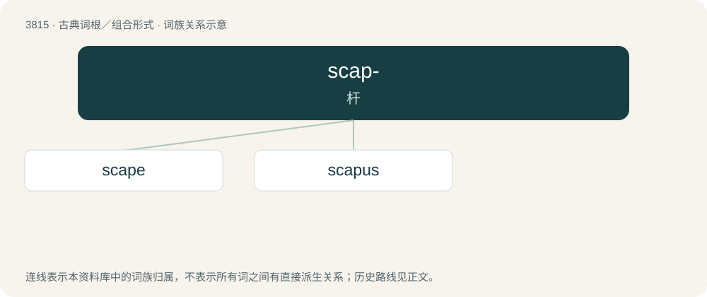

# 3847 · scap- — 杆

[总目录](../00_总目录_按常用程度.md)

**类型**：古典词根／组合形式　｜　**来源语言**：古希腊语

## 核心含义与来源

- 核心含义：杆
- 英文含义：shaft
- 词形：scap-

**来源词形**：σκᾶπος (skâpos)

## 词族图

## 单词速览（常用到不常用）

| 单词 | 音标 | 释义 |
|---|---|---|
| [scape](#w-1) | /ˈskeɪp/ | \[医\] 柄节(昆虫) |
| [scapus](#w-2) | /ˈskeipəs/ | 干茎 |

## 逐词详解

### 1. scape

**词性**：名词　｜　**音标**：/ˈskeɪp/

**中文释义**：\[医\] 柄节(昆虫)

**英文义项**：A leafless stalk growing directly out of a root, bulb, or subterranean structure. / The basal segment of an insect's antenna (i.e. the part closest to the body).

**词源与演化**：

From Latin scāpus, from Doric Greek σκᾶπος (skâpos). Doublet of native English shaft.

### 2. scapus

**词性**：名词　｜　**音标**：/ˈskeipəs/

**中文释义**：干茎

**英文义项**：A scape. / scape (shaft of a column).

**词源与演化**：

From Latin scapus (“shaft”).
