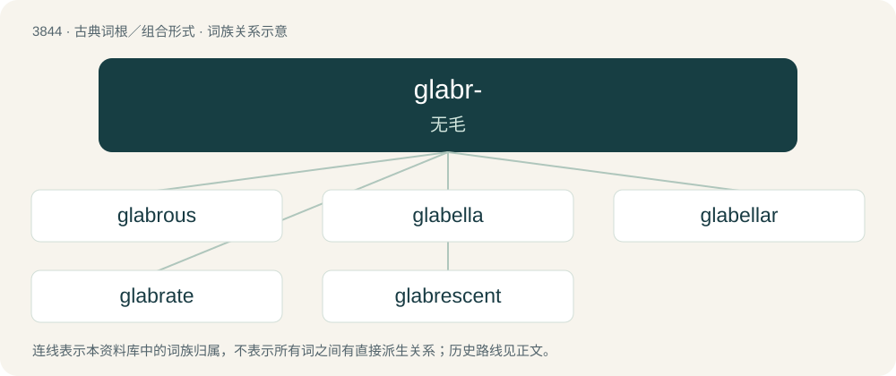

# 3874 · glabr- — 无毛

[总目录](../00_总目录_按常用程度.md)

**类型**：古典词根／组合形式　｜　**来源语言**：拉丁语

## 核心含义与来源

- 核心含义：无毛
- 英文含义：hairless
- 词形：glabr-

**来源词形**：glaber

## 词族图

## 单词速览（常用到不常用）

| 单词 | 音标 | 释义 |
|---|---|---|
| [glabrous](#w-1) | 英 /ˈɡleɪbɹəs/；美 /ˈɡleɪbɹəs/ | a. 无毛的, 光滑的, 光洁的；\[医\] 光滑的, 光秃的 |
| [glabella](#w-2) | 美 /ɡləˈbɛlə/ | n. \[解\]眉间, 印堂 |
| [glabellar](#w-3) |  | \[医\] 眉间的 |
| [glabrate](#w-4) | /ˈ^leibreit, -brit/ | a. \[生\]平滑的, 平秃的 |
| [glabrescent](#w-5) | /ɡleɪˈbɹɛsənt/ | a. \[生\]会变成无毛的 |

## 逐词详解

### 1. glabrous

**词性**：形容词　｜　**音标**：英 /ˈɡleɪbɹəs/；美 /ˈɡleɪbɹəs/

**中文释义**：a. 无毛的, 光滑的, 光洁的；\[医\] 光滑的, 光秃的

**英文义项**：Bald, hairless; smooth.

**词源与演化**：

From Latin glaber (“smooth; bald, hairless”) + English -ous (suffix forming adjectives, denoting possession or presence of a quality in any degree, commonly in abundance). Glaber is ultimately derived from Proto-Indo-European \*gʰleh₂dʰ- (“smooth; bright, shining”), possibly from \*ǵʰelh₂- (“to shine”).

### 2. glabella

**词性**：名词　｜　**音标**：美 /ɡləˈbɛlə/

**中文释义**：n. \[解\]眉间, 印堂

**英文义项**：The space between the eyebrows and above the nose. / The axial protuberance on the cephalon of certain arthropods (especially trilobites).

**词源与演化**：

From Latin glaber (“smooth, hairless, bald”).

**例句**：

> The space between the eyebrows is called the glabella.

### 3. glabellar

**词性**：形容词

**中文释义**：\[医\] 眉间的

**英文义项**：Of, or pertaining to, the glabella.

**构词拆分**：glabella + -ar

**词源与演化**：

From glabella + -ar.

### 4. glabrate

**词性**：形容词　｜　**音标**：/ˈ^leibreit, -brit/

**中文释义**：a. \[生\]平滑的, 平秃的

**英文义项**：Becoming smooth (as if with age). / Somewhat glabrous.

### 5. glabrescent

**词性**：形容词　｜　**音标**：/ɡleɪˈbɹɛsənt/

**中文释义**：a. \[生\]会变成无毛的

**英文义项**：Becoming glabrous, hairless, or smooth; glabrate.
