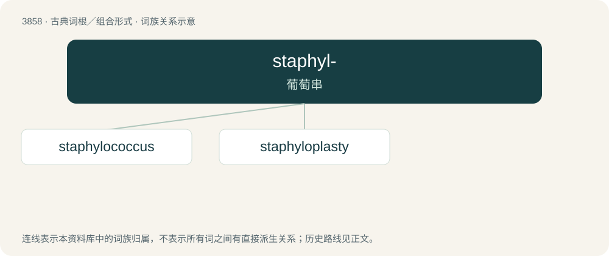

# 3883 · staphyl- — 葡萄串

[总目录](../00_总目录_按常用程度.md)

**类型**：古典词根／组合形式　｜　**来源语言**：古希腊语

## 核心含义与来源

- 核心含义：葡萄串
- 英文含义：bunch of grapes
- 词形：staphyl-

**来源词形**：σταφυλή (staphulḗ)

## 词族图

## 单词速览（常用到不常用）

| 单词 | 音标 | 释义 |
|---|---|---|
| [staphylococcus](#w-1) | /ˌstæfələˈkɔkəs/ | n. 葡萄球菌；\[医\] 葡萄球菌属 |
| [staphyloplasty](#w-2) | /ˈstæfiləu,plæsti/ | n. \[医\]悬雍垂成形术 |

## 逐词详解

### 1. staphylococcus

**词性**：名词　｜　**音标**：/ˌstæfələˈkɔkəs/

**中文释义**：n. 葡萄球菌；\[医\] 葡萄球菌属

**英文义项**：A spherical gram-positive parasitic bacterium of the genus Staphylococcus, causing blisters, septicemia, and other infections.

**词源与演化**：

Borrowed from translingual Staphylococcus. By surface analysis, staphylo- + -coccus.

### 2. staphyloplasty

**词性**：名词　｜　**音标**：/ˈstæfiləu,plæsti/

**中文释义**：n. \[医\]悬雍垂成形术

**英文义项**：Plastic surgery to replace or repair the uvula and the soft palate.

**构词拆分**：staphylo- + -plasty

**词源与演化**：

From staphylo- + -plasty.

## 其他候选词

- staphyledema
- staphylion
- staphyloderma
