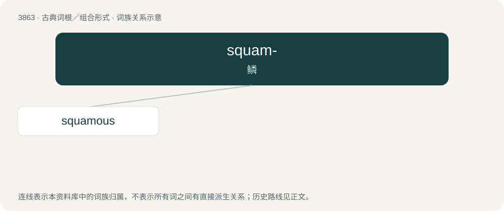

# 3890 · squam- — 鳞

[总目录](../00_总目录_按常用程度.md)

**类型**：古典词根／组合形式　｜　**来源语言**：拉丁语

## 核心含义与来源

- 核心含义：鳞
- 英文含义：scale
- 词形：squam-

**来源词形**：squama

## 词族图

## 单词速览（常用到不常用）

| 单词 | 音标 | 释义 |
|---|---|---|
| [squamous](#w-1) | 英 /ˈskweɪ.məs/；美 /ˈskweɪ.məs/ | a. 有鳞的, 多鳞的, 鳞状的；\[医\] 鳞状的, 鳞屑的 |

## 逐词详解

### 1. squamous

**词性**：形容词　｜　**音标**：英 /ˈskweɪ.məs/；美 /ˈskweɪ.məs/

**中文释义**：a. 有鳞的, 多鳞的, 鳞状的；\[医\] 鳞状的, 鳞屑的

**英文义项**：Covered with, made of, or resembling scales; scaly. / Of or pertaining to the squamosal bone; squamosal

**词源与演化**：

From Middle English squamous, from Latin squāmōsus, from squāma (“scale(of a fish or reptile)”).
