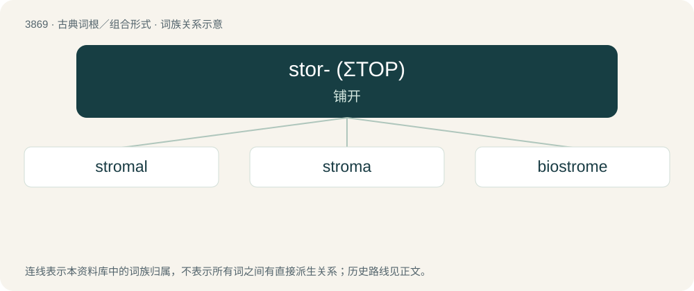

# 3896 · stor- (ΣΤΟΡ) — 铺开

[总目录](../00_总目录_按常用程度.md)

**类型**：古典词根／组合形式　｜　**来源语言**：古希腊语

## 核心含义与来源

- 核心含义：铺开
- 英文含义：spread, strew
- 词形：stor-

**来源词形**：στορέννυμι (storénnumi), στόρνυμι, στρῶμα (strôma)

## 词族图

## 单词速览（常用到不常用）

| 单词 | 音标 | 释义 |
|---|---|---|
| [stromal](#w-1) | 英 /ˈstɹəʊ̯.məl/；美 /ˈstɹoʊ̯.məl/ | \[医\] 基质的 |
| [stroma](#w-2) | 英 /ˈstɹəʊ̯.mə/；美 /ˈstɹoʊ̯.mə/ | n. 基质, 底质, 底座；\[化\] 叶绿体基质 |
| [biostrome](#w-3) | /ˈbaiəu,strəum/ | n. \[地\]生物层 |

## 逐词详解

### 1. stromal

**词性**：形容词　｜　**音标**：英 /ˈstɹəʊ̯.məl/；美 /ˈstɹoʊ̯.məl/

**中文释义**：\[医\] 基质的

**英文义项**：Of or relating to a stroma. / Of or relating to sister chromatid cohesion.

**构词拆分**：From stroma + -al.

**词源与演化**：

From stroma + -al.

### 2. stroma

**词性**：名词　｜　**音标**：英 /ˈstɹəʊ̯.mə/；美 /ˈstɹoʊ̯.mə/

**中文释义**：n. 基质, 底质, 底座；\[化\] 叶绿体基质

**英文义项**：The tissue structure of an organ, etc., that serves to support it.

**词源与演化**：

From Latin strōma (“mattress, bed covering”), from Ancient Greek στρῶμα (strôma, “bed”), from στόρνυμι (stórnumi, “to stretch out”).

### 3. biostrome

**词性**：名词　｜　**音标**：/ˈbaiəu,strəum/

**中文释义**：n. \[地\]生物层

**英文义项**：A horizontally bedded stratum of fossilized remains of sedentary organisms

**词源与演化**：

bio- (“life”) + Latin stroma (“coverlet”), from Ancient Greek στρῶμα (strôma, “bed, mattress”).
