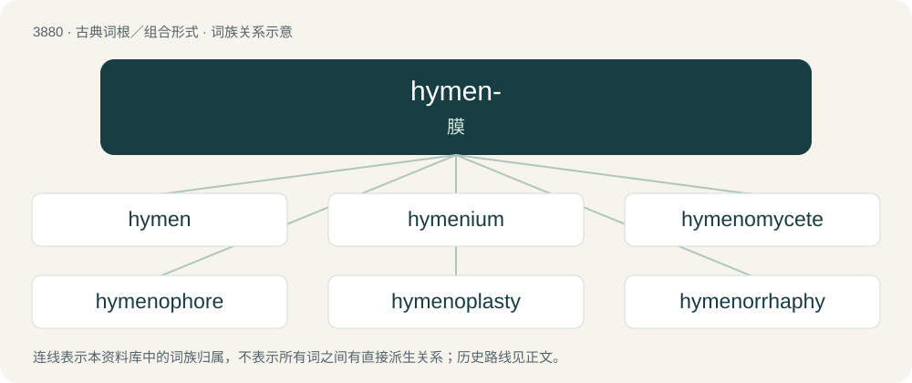

# 3909 · hymen- — 膜

[总目录](../00_总目录_按常用程度.md)

**类型**：古典词根／组合形式　｜　**来源语言**：古希腊语

## 核心含义与来源

- 核心含义：膜
- 英文含义：skin or membrane
- 词形：hymen-

**来源词形**：ὑμήν, ὑμένος (humḗn, huménos)

## 词族图

## 单词速览（常用到不常用）

| 单词 | 音标 | 释义 |
|---|---|---|
| [hymen](#w-1) | /ˈhaɪmən/ | n. 结婚, 处女膜, 许门(婚姻之神)；\[医\] 处女膜 |
| [hymenium](#w-2) | /haiˈmiːniəm/ | n. \[植\]子实层, 子囊层 |
| [hymenomycete](#w-3) |  | 【英文】Any fungus with a fruiting body whose hymenophore develops either unenclosed or enclosed only with a velum. |
| [hymenophore](#w-4) | /hiːˈmenəʊfr/ | 子实层柄, 子实层体 |
| [hymenoplasty](#w-5) |  | 【英文】Plastic surgery affecting a woman's hymen, usually involving reconstruction to the unbroken condition ordinarily characteristic of virginity. |
| [hymenorrhaphy](#w-6) |  | \[医\] 处女膜缝合术 |
| [hymenotomy](#w-7) | /,haiməˈnɔtəmi/ | n. \[医\]处女膜切开(术), 膜切开术 |

## 逐词详解

### 1. hymen

**词性**：名词　｜　**音标**：/ˈhaɪmən/

**中文释义**：n. 结婚, 处女膜, 许门(婚姻之神)；\[医\] 处女膜

**英文义项**：A membrane which completely or partially occludes the vaginal opening in human females. / Marriage.

**词源与演化**：

From Middle French hymen, from Late Latin hymēn, from Ancient Greek ὑμήν (humḗn, “skin; membrane”).

**例句**：

> When a girl has sex for the first time, her hymen ruptures and bleeds.

### 2. hymenium

**词性**：名词　｜　**音标**：/haiˈmiːniəm/

**中文释义**：n. \[植\]子实层, 子囊层

**英文义项**：The sporebearing surface of a fungus.

**词源与演化**：

From ὑμήν (humḗn, “membrane”) + -ium.

### 3. hymenomycete

**词性**：名词

**英文义项**：Any fungus with a fruiting body whose hymenophore develops either unenclosed or enclosed only with a velum.

### 4. hymenophore

**词性**：名词　｜　**音标**：/hiːˈmenəʊfr/

**中文释义**：子实层柄, 子实层体

**英文义项**：The part of a fungus fruiting body which produces spore-bearing cells.

**构词拆分**：-o- + -phore

**词源与演化**：

From Ancient Greek ὑμήν (humḗn, “membrane”) + English -o- + -phore.

### 5. hymenoplasty

**词性**：名词

**英文义项**：Plastic surgery affecting a woman's hymen, usually involving reconstruction to the unbroken condition ordinarily characteristic of virginity.

**构词拆分**：hymen + -o- + -plasty

**词源与演化**：

From hymen + -o- + -plasty.

### 6. hymenorrhaphy

**词性**：名词

**中文释义**：\[医\] 处女膜缝合术

**英文义项**：Reconstructive surgery in which a woman's hymen is restored to the unbroken condition ordinarily characteristic of virginity.

**构词拆分**：hymen + -o- + -rrhaphy

**词源与演化**：

From hymen + -o- + -rrhaphy.

### 7. hymenotomy

**词性**：名词　｜　**音标**：/,haiməˈnɔtəmi/

**中文释义**：n. \[医\]处女膜切开(术), 膜切开术

**英文义项**：The surgical removal or opening of the hymen.

**构词拆分**：hymen + -otomy

**词源与演化**：

From hymen + -otomy.

## 其他候选词

- Hymenoptera
