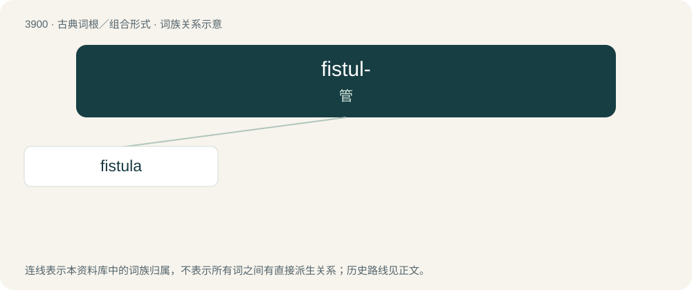

# 3923 · fistul- — 管

[总目录](../00_总目录_按常用程度.md)

**类型**：古典词根／组合形式　｜　**来源语言**：拉丁语

## 核心含义与来源

- 核心含义：管
- 英文含义：hollow, tube
- 词形：fistul-

**来源词形**：fistula

## 词族图

## 单词速览（常用到不常用）

| 单词 | 音标 | 释义 |
|---|---|---|
| [fistula](#w-1) | 英 /ˈfɪs.tjə.lə/；美 /ˈfɪs.tjə.lə/ | n. 瘘, 瘘管；\[医\] 瘘, 瘘管 |

## 逐词详解

### 1. fistula

**词性**：名词　｜　**音标**：英 /ˈfɪs.tjə.lə/；美 /ˈfɪs.tjə.lə/

**中文释义**：n. 瘘, 瘘管；\[医\] 瘘, 瘘管

**英文义项**：An abnormal connection or passageway between organs or vessels that normally do not connect. / A tube, a pipe, or a hole.

**词源与演化**：

Learned borrowing from Latin fistula (“pipe, ulcer, catheter”). Doublet of fester.

**用法示例／搭配（非完整句）**：

> communicating fistula

该用例对应义项：An abnormal connection or passageway between organs or vessels that normally do not connect.
