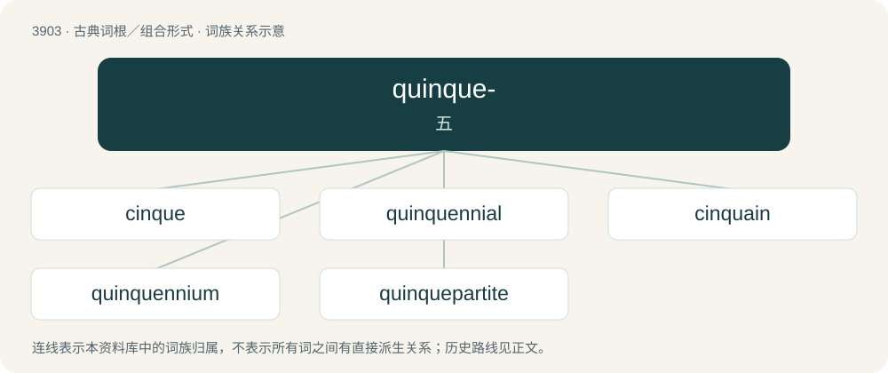

# 3926 · quinque- — 五

[总目录](../00_总目录_按常用程度.md)

**类型**：古典词根／组合形式　｜　**来源语言**：拉丁语

## 核心含义与来源

- 核心含义：五
- 英文含义：five
- 词形：quinque-

**来源词形**：quinque

## 词族图

## 单词速览（常用到不常用）

| 单词 | 音标 | 释义 |
|---|---|---|
| [cinque](#w-1) | 英 /sɪŋk/ | n. 五, 五点 |
| [quinquennial](#w-2) | /kwɪŋˈkwɛ.ni.əl/ | a. 持续五年的, 每五年一次的 |
| [cinquain](#w-3) | /sɪŋ.keɪn/ | n. 五个的一组, 五行诗 |
| [quinquennium](#w-4) | 英 /kwɪŋˈkwɛnɪəm/；美 /kwɪŋˈkwɛniəm/ | n. 五年的时间 |
| [quinquepartite](#w-5) | /.kwiŋkwiˈpɑːtait/ | a. 分成五部分的, 由五部分构成的 |

## 逐词详解

### 1. cinque

**词性**：名词　｜　**音标**：英 /sɪŋk/

**中文释义**：n. 五, 五点

**英文义项**：A card, die, or domino with five spots or pips.

**词源与演化**：

From Middle English cynk, from Middle French cinq, from Latin cīnque, variant of quīnque. The archaic spelling cinq is taken from modern French cinq, whereas the standard spelling is perhaps influenced by Italian cinque or a misspelling of the French. The variant pronunciation /sæŋk/ is based on Modern French. Doublet of fin (“five currency units”), finnuf, five, pimp (“five”), ponzu, punch (“beverage”), and sengi (“currency”); related to Pompeii.

### 2. quinquennial

**词性**：形容词　｜　**音标**：/kwɪŋˈkwɛ.ni.əl/

**中文释义**：a. 持续五年的, 每五年一次的

**英文义项**：Of or related to a five-year period.

**词源与演化**：

Borrowed from Latin quīnquenniālis, from quīnquennium (“5-year period”) + -ālis, from quīnquennis (“5-year”) + -ium (“-ium: forming abstract nouns”), from quīnque (“five”) + annus (“year”) + -is (suffix forming compound adjectives).

**例句**：

> The Athenians, after the purification, celebrated, for the first time, the quinquennial festival of the Delian games.

### 3. cinquain

**词性**：名词　｜　**音标**：/sɪŋ.keɪn/

**中文释义**：n. 五个的一组, 五行诗

**英文义项**：A five-line poetic form which consists of 2, 4, 6, 8 then 2 syllables. / A five-line poetic form set as a writing exercise for children, consisting of one noun, two adjectives, three actions, four feeling words, and the initial noun again.

**词源与演化**：

Borrowed from French cinquain.

### 4. quinquennium

**词性**：名词　｜　**音标**：英 /kwɪŋˈkwɛnɪəm/；美 /kwɪŋˈkwɛniəm/

**中文释义**：n. 五年的时间

**英文义项**：A period of five years.

**词源与演化**：

From Latin quīnquennium, from quinquennis (“5-year”) + -ium (suffix forming abstract nouns).

**例句**：

> During the quinquennium from 1991 to 1995, infant mortality increased.

该用例对应义项：A period of five years.

### 5. quinquepartite

**词性**：形容词　｜　**音标**：/.kwiŋkwiˈpɑːtait/

**中文释义**：a. 分成五部分的, 由五部分构成的

**英文义项**：Consisting of five parts.

**构词拆分**：quinque- + partite

**词源与演化**：

From quinque- + partite.

## 其他候选词

- quinquefoil
- quinquevalent
