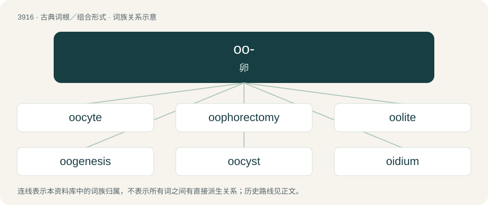

# 3944 · oo- — 卵

[总目录](../00_总目录_按常用程度.md)

**类型**：古典词根／组合形式　｜　**来源语言**：古希腊语

## 核心含义与来源

- 核心含义：卵
- 英文含义：egg
- 词形：oo-

**来源词形**：ᾠόν (ōión)

## 词族图

## 单词速览（常用到不常用）

| 单词 | 音标 | 释义 |
|---|---|---|
| [oocyte](#w-1) | 英 /ˈəʊəsaɪt/；美 /ˈoʊəsaɪt/ | n. 卵母细胞；\[医\] 卵母细胞 |
| [oophorectomy](#w-2) | /oʊˌɒfəˈɹɛktəmi/ | n. \[医\]卵巢切除术 |
| [oolite](#w-3) | 英 /ˈəʊəlʌɪt/ | n. \[地质\]鱼卵石, 鱼卵状石灰石,鲕粒岩 |
| [oogenesis](#w-4) | 美 /ˈoʊ.oʊ.d͡ʒɛn.ə.sɪs/ | n. \[生\]卵子发生, 成卵法 |
| [oocyst](#w-5) | 英 /ˈəʊəsɪst/ | \[医\] 卵囊, 卵袋 |
| [oidium](#w-6) | /əuˈidiəm/ | 粉孢子 |
| [bottarga](#w-7) |  | 【英文】A Mediterranean dish of cured fish roe |
| [ootheca](#w-8) | /əʊəˈθiːkə/ | n. 卵巢；\[医\] 卵巢, 卵鞘, 卵巢 |
| [epoophoron](#w-9) | /,epəˈɔfərɔn/ | n. \[解\]卵巢冠 |
| [oidioid](#w-10) |  | 【英文】Of or relating to the fungus genus Oidium. |
| [ooblast](#w-11) | /ˈəuə,blɑːst/ | 成卵细胞 |
| [oocytogenesis](#w-12) |  | 【英文】The creation and development of oocytes |
| [oogamete](#w-13) | /,əjə^əˈmiːt,-ˈ^æmiːt/ | n. \[生\]雌配子 |
| [oogamous](#w-14) | /əuˈɔ^əməs/ | a. \[生\]卵配生殖的 |
| [oogamy](#w-15) | /oʊˈɒɡəmi/ | n. \[生\]卵式生殖,异配生殖 |
| [oogonium](#w-16) | /,əuəˈ^əuniəm/ | n. \[生\]卵原细胞, 藏卵器 |
| [ooid](#w-17) | 英 /ˈəʊˌɔɪd/；美 /ˈoʊˌɔɪd/ | 鲕粒 |
| [oolith](#w-18) | 英 /ˈəʊəlɪθ/；美 /ˈoʊəˌlɪθ/ | n. \[地\]鲕粒(指构成鲕粒岩的基本粒子) |
| [oology](#w-19) | 英 /əʊ̯ˈ(w)ɒləd͡ʒi/；美 /oʊ̯ˈ(w)ɑləd͡ʒi/ | n. 鸟卵学 |
| [oomancy](#w-20) |  | 【英文】Divination through the use of eggs. |
| [oophagy](#w-21) | 英 /əʊˈɒfədʒi/ | 【英文】The eating of eggs; (now especially) the cannibalization of subordinate eggs within a homogeneous population or the uterus; particularly as it relates to certain insect and aquatic species. |
| [oophoron](#w-22) | /oʊˈɒfəɹɒn/ | \[医\] 卵巢, 子房 |
| [ootid](#w-23) | /ˈəuətid/ | n. 卵细胞；\[医\] 卵细胞 |
| [ootidogenesis](#w-24) |  | 【英文】The part of oogenesis leading to the formation of ootids |
| [paroophoron](#w-25) | /,pærəuˈɔfərɔn/ | 卵巢旁体 |

## 逐词详解

### 1. oocyte

**词性**：名词　｜　**音标**：英 /ˈəʊəsaɪt/；美 /ˈoʊəsaɪt/

**中文释义**：n. 卵母细胞；\[医\] 卵母细胞

**英文义项**：A cell that develops into an egg or ovum; a female gametocyte.

**构词拆分**：oo- + -cyte

**词源与演化**：

From oo- + -cyte.

### 2. oophorectomy

**词性**：名词　｜　**音标**：/oʊˌɒfəˈɹɛktəmi/

**中文释义**：n. \[医\]卵巢切除术

**英文义项**：The surgical removal of one or both ovaries, usually performed to treat or prevent conditions such as ovarian cancer, ovarian cysts, endometriosis, or other ovarian disorders.

**词源与演化**：

By surface analysis, oophor- + -ectomy.

**例句**：

> The surgical removal of an ovary or ovaries is called an oophorectomy.

### 3. oolite

**词性**：名词　｜　**音标**：英 /ˈəʊəlʌɪt/

**中文释义**：n. \[地质\]鱼卵石, 鱼卵状石灰石,鲕粒岩

**英文义项**：A rock consisting of spherical grains within a mineral cortex accreted around a nucleus, often of quartz grains. / An ooid or oolith.

**构词拆分**：oo- + -lite

**词源与演化**：

From oo- + -lite, after German Oolit.

### 4. oogenesis

**词性**：名词　｜　**音标**：美 /ˈoʊ.oʊ.d͡ʒɛn.ə.sɪs/

**中文释义**：n. \[生\]卵子发生, 成卵法

**英文义项**：The formation and development of an oocyte or ovum

**构词拆分**：oo- + -genesis

**词源与演化**：

From oo- + -genesis.

### 5. oocyst

**词性**：名词　｜　**音标**：英 /ˈəʊəsɪst/

**中文释义**：\[医\] 卵囊, 卵袋

**英文义项**：A reproductive cell in certain fungi. / A thick-walled spore in the lifecycle of some parasitic protozoans that develops into sporozoite.

**构词拆分**：oo- + cyst

**词源与演化**：

From oo- + cyst.

### 6. oidium

**词性**：名词　｜　**音标**：/əuˈidiəm/

**中文释义**：粉孢子

**英文义项**：A fragile spore produced by some fungi. / The fungus Erysiphe necator (= Uncinula necator), which produces powdery mildew in grapes.

**词源与演化**：

From New Latin ōidium, equivalent to Ancient Greek ᾠόν (ōión, “egg”) + -idium.

### 7. bottarga

**词性**：名词

**英文义项**：A Mediterranean dish of cured fish roe

**词源与演化**：

Borrowed from Italian bottarga. Doublet of tarek.

### 8. ootheca

**词性**：名词　｜　**音标**：/əʊəˈθiːkə/

**中文释义**：n. 卵巢；\[医\] 卵巢, 卵鞘, 卵巢

**英文义项**：An egg case of any of the orthopteroid insects (such as cockroaches and mantids). / The theca or sporangium of ferns.

**构词拆分**：From oo- (“egg-”) + theca (“sheath”).

**词源与演化**：

From oo- (“egg-”) + theca (“sheath”).

### 9. epoophoron

**词性**：名词　｜　**音标**：/,epəˈɔfərɔn/

**中文释义**：n. \[解\]卵巢冠

**英文义项**：A group of tubules, a remnant of the Wolffian body, often found near the ovary or oviduct.

**词源与演化**：

From Ancient Greek ἐπι- (epi-, “upon”) + ᾠόν (ōión, “egg”) + φέρω (phérō, “bear”). By surface analysis, ep- + oo- + -phor + Ancient Greek -όν (-ón, “singular noun ending”).

### 10. oidioid

**词性**：形容词

**英文义项**：Of or relating to the fungus genus Oidium.

### 11. ooblast

**词性**：名词　｜　**音标**：/ˈəuə,blɑːst/

**中文释义**：成卵细胞

**英文义项**：A cell that develops into an ovum; a germinal epithelium giving rise to ova.

**构词拆分**：oo- + -blast

**词源与演化**：

From oo- + -blast.

### 12. oocytogenesis

**词性**：名词

**英文义项**：The creation and development of oocytes

**构词拆分**：oocyte + -o- + genesis

**词源与演化**：

From oocyte + -o- + genesis.

### 13. oogamete

**词性**：名词　｜　**音标**：/,əjə^əˈmiːt,-ˈ^æmiːt/

**中文释义**：n. \[生\]雌配子

**英文义项**：The female gamete; the egg cell or oosphere.

**构词拆分**：oo- + gamete

**词源与演化**：

From oo- + gamete.

### 14. oogamous

**词性**：形容词　｜　**音标**：/əuˈɔ^əməs/

**中文释义**：a. \[生\]卵配生殖的

**英文义项**：Of or relating to oogamy

**构词拆分**：oo- + -gamous

**词源与演化**：

From oo- + -gamous.

### 15. oogamy

**词性**：名词　｜　**音标**：/oʊˈɒɡəmi/

**中文释义**：n. \[生\]卵式生殖,异配生殖

**英文义项**：A form of anisogamy (heterogamy) in which the female gamete (e.g. ovum) is significantly larger than the male gamete (sperm) and is non-motile.

**构词拆分**：oo- + -gamy

**词源与演化**：

From oo- + -gamy.

### 16. oogonium

**词性**：名词　｜　**音标**：/,əuəˈ^əuniəm/

**中文释义**：n. \[生\]卵原细胞, 藏卵器

**英文义项**：An immature ovarian egg within a developing fetus. / A sac (the female gametangium) containing oospheres in algae or fungi.

**构词拆分**：oo- + -gonium

**词源与演化**：

From oo- + -gonium.

### 17. ooid

**词性**：名词　｜　**音标**：英 /ˈəʊˌɔɪd/；美 /ˈoʊˌɔɪd/

**中文释义**：鲕粒

**英文义项**：A small calcium carbonate- or iron-coated grain found on the seafloor.

**构词拆分**：oo- (“egg”) + -id

**词源与演化**：

From oo- (“egg”) + -id.

### 18. oolith

**词性**：名词　｜　**音标**：英 /ˈəʊəlɪθ/；美 /ˈoʊəˌlɪθ/

**中文释义**：n. \[地\]鲕粒(指构成鲕粒岩的基本粒子)

**英文义项**：A spherical granule of which oolite is composed, formed by concentric accretion of thin layers of a mineral (usually calcium carbonate (limestone) but also others such as dolomite and silica) around a core; an ooid. / Oolite.

**构词拆分**：oo- + -lith

**词源与演化**：

Borrowed from Late Latin oolithus; the Latin word was coined by the German doctor and mineralogist Franz Ernst Brückmann (1697–1753) as a translation of German Rogenstein (“oolite”) (Rogen (“fish roe”) + Stein (“stone”)). Oolithus is derived from Ancient Greek ᾠόν (ōión, “egg; seed”) (possibly ultimately from Proto-Indo-European \*h₂ew- (“to clothe oneself, dress; to be dressed”), in the sense of a bird being clothed in feathers) + λῐ́θος (lĭ́thos, “a stone; stone as a substance”) (see further at that entry), analysable as oo- + -lith.

### 19. oology

**词性**：名词　｜　**音标**：英 /əʊ̯ˈ(w)ɒləd͡ʒi/；美 /oʊ̯ˈ(w)ɑləd͡ʒi/

**中文释义**：n. 鸟卵学

**英文义项**：The study of birds' eggs. / The hobby or practice of collecting birds' eggs, especially those of wild birds.

**构词拆分**：oo- (“relating to eggs or ova”, prefix) + -logy (“branch of learning or study of a subject”, suffix)

**词源与演化**：

From oo- (“relating to eggs or ova”, prefix) + -logy (“branch of learning or study of a subject”, suffix). The word is cognate with French oologie, Late Latin ōologia.

### 20. oomancy

**词性**：名词

**英文义项**：Divination through the use of eggs.

**构词拆分**：oo- + -mancy

**词源与演化**：

From oo- + -mancy; from Ancient Greek ᾠο- (ōio-) + μᾰντείᾱ (mănteíā, “divination”).

### 21. oophagy

**词性**：名词　｜　**音标**：英 /əʊˈɒfədʒi/

**英文义项**：The eating of eggs; (now especially) the cannibalization of subordinate eggs within a homogeneous population or the uterus; particularly as it relates to certain insect and aquatic species.

**构词拆分**：oo- + -phagy

**词源与演化**：

From oo- + -phagy, originally after German Oophagie.

### 22. oophoron

**词性**：名词　｜　**音标**：/oʊˈɒfəɹɒn/

**中文释义**：\[医\] 卵巢, 子房

**英文义项**：Synonym of ovary.

**词源与演化**：

Learned borrowing from Ancient Greek ᾠοφόρον (ōiophóron, “egg-bearer”), neuter of ᾠοφόρος (ōiophóros, “egg-bearing”). By surface analysis, oo- + -phore + -on.

### 23. ootid

**词性**：名词　｜　**音标**：/ˈəuətid/

**中文释义**：n. 卵细胞；\[医\] 卵细胞

**英文义项**：The haploid cell, produced by meiotic division of a secondary oocyte, that is a nearly mature ovum.

### 24. ootidogenesis

**词性**：名词

**英文义项**：The part of oogenesis leading to the formation of ootids

**构词拆分**：ootid + -o- + -genesis

**词源与演化**：

From ootid + -o- + -genesis.

### 25. paroophoron

**词性**：名词　｜　**音标**：/,pærəuˈɔfərɔn/

**中文释义**：卵巢旁体

**英文义项**：A small mass of tubules in the broad ligament near the ovary in some animals, including humans.

**构词拆分**：para- + oophoron

**词源与演化**：

From para- + oophoron.

## 其他候选词

- dioon
