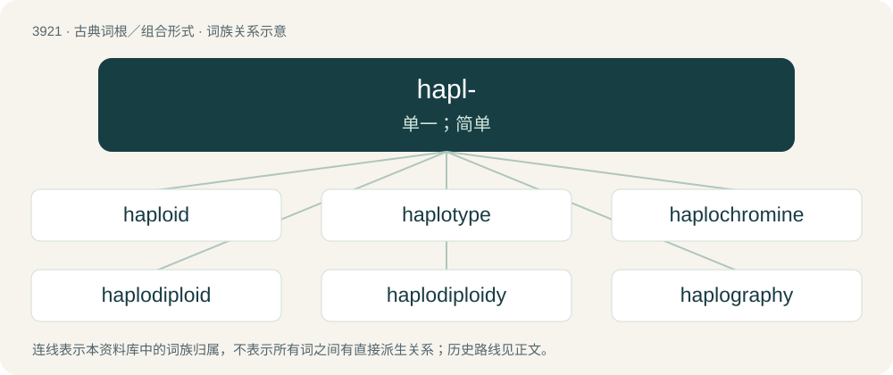

# 3949 · hapl- — 单一；简单

[总目录](../00_总目录_按常用程度.md)

**类型**：古典词根／组合形式　｜　**来源语言**：古希腊语

## 核心含义与来源

- 核心含义：单一；简单
- 英文含义：simple, single
- 词形：hapl-

**来源词形**：ἁπλοῦς (haploûs), ἅπλωσις (háplōsis), ἅπλωμα (háplōma)

## 词族图

## 单词速览（常用到不常用）

| 单词 | 音标 | 释义 |
|---|---|---|
| [haploid](#w-1) | /ˈhæplɔɪd/ | \[医\] 单倍体, 单倍的 |
| [haplotype](#w-2) | /ˈhap.lə(ʊ).taɪp/ | 单模标本 |
| [haplochromine](#w-3) |  | \[网络\] 湖会摄食刺棘类淡水热带鱼；单色鲷属 |
| [haplodiploid](#w-4) | /hæpˈləʊdɪplɔɪd/ | \[医\]单倍二倍体（染色体） |
| [haplodiploidy](#w-5) | /hæpləʊdɪpˈlɔɪdɪ/ | 单倍二倍性 |
| [haplography](#w-6) | /hæpˈlɒɡ.ɹə.fi/ | n. \[语\]掉字,漏写 |
| [haplology](#w-7) | /hæˈplɒləd͡ʒi/ | n. 掉音, 漏发音, 重复音略读 |
| [haplont](#w-8) | /ˈhæplɔnt/ | n. \[生\]单倍性生物 , 单倍体 , 单元体 |
| [haplontic](#w-9) | /hæpˈlɒntɪk/ | \[医\]单倍性生物的 |
| [haplophase](#w-10) | /ˈhæpləu,feiz/ | \[生\]单元期 |
| [haplopia](#w-11) | /hæpˈləjpiə/ | n. \[医\]单视(视力正常) |
| [haplosis](#w-12) | /hæˈpləusis/ | n. \[生物\]减半作用 |

## 逐词详解

### 1. haploid

**词性**：形容词　｜　**音标**：/ˈhæplɔɪd/

**中文释义**：\[医\] 单倍体, 单倍的

**英文义项**：Having the number of chromosomes that a typical gamete has (in the given organism), namely, half the number that a typical somatic cell has (in the given organism). / Having a single set of unpaired chromosomes (which is the number that a typical gamete has in many organisms although not all).

**构词拆分**：haplo- + -oid

**词源与演化**：

From haplo- + -oid, Ancient Greek roots meaning, together, literally “simplex” or “onefoldlike”, from ᾰ̔πλόος (hăplóos, “single, simple”, literally “onefold”) and -ειδής (-eidḗs, “-like”).

**例句**：

> Examples of haploid cells are prokaryotes and the gametes of eukaryotes.

该用例对应义项：Having a single set of unpaired chromosomes (which is the number that a typical gamete has in many organisms although not all).

### 2. haplotype

**词性**：名词　｜　**音标**：/ˈhap.lə(ʊ).taɪp/

**中文释义**：单模标本

**英文义项**：A haploid genotype: a group of alleles that are transmitted together.

**构词拆分**：haplo- + -type

**词源与演化**：

From haplo- + -type.

### 3. haplochromine

**词性**：名词

**中文释义**：\[网络\] 湖会摄食刺棘类淡水热带鱼；单色鲷属

**英文义项**：Any cichlid of the tribe Haplochromini.

**词源与演化**：

From translingual Haplochromini, with the tribe suffix -ini changed to English -ine

### 4. haplodiploid

**词性**：形容词　｜　**音标**：/hæpˈləʊdɪplɔɪd/

**中文释义**：\[医\]单倍二倍体（染色体）

**英文义项**：In which members of one sex are haploid and members of the other are diploid; found especially in the Hymenoptera

**构词拆分**：haplo- + diploid

**词源与演化**：

From haplo- + diploid.

### 5. haplodiploidy

**词性**：名词　｜　**音标**：/hæpləʊdɪpˈlɔɪdɪ/

**中文释义**：单倍二倍性

**英文义项**：A sex-determination system in which males develop from unfertilized eggs and are haploid, and females develop from fertilized eggs and are diploid.

### 6. haplography

**词性**：名词　｜　**音标**：/hæpˈlɒɡ.ɹə.fi/

**中文释义**：n. \[语\]掉字,漏写

**英文义项**：Accidental omission of a letter or letter group that should be repeated in writing, for example, mispell for misspell.

**构词拆分**：haplo- + -graphy

**词源与演化**：

From haplo- + -graphy.

### 7. haplology

**词性**：名词　｜　**音标**：/hæˈplɒləd͡ʒi/

**中文释义**：n. 掉音, 漏发音, 重复音略读

**英文义项**：The process of deleting one of two almost identical syllables within a word. / An instance of said process.

**构词拆分**：haplo- + -logy

**词源与演化**：

From haplo- + -logy.

### 8. haplont

**词性**：名词　｜　**音标**：/ˈhæplɔnt/

**中文释义**：n. \[生\]单倍性生物 , 单倍体 , 单元体

**英文义项**：Any haplontic organism; any organism whose zygotes undergo zygotic meiosis (meiosis immediately after the fusion of cell nuclei).

**构词拆分**：haplo- + -ont

**词源与演化**：

From haplo- + -ont, ultimately from Ancient Greek ἁπλόος (haplóos, “single, simple”).

### 9. haplontic

**词性**：形容词　｜　**音标**：/hæpˈlɒntɪk/

**中文释义**：\[医\]单倍性生物的

**英文义项**：Describing an organism that is haploid for most of its life cycle but that briefly has a diploid zygote

### 10. haplophase

**词性**：名词　｜　**音标**：/ˈhæpləu,feiz/

**中文释义**：\[生\]单元期

**英文义项**：The haploid phase in the life cycle of an organism

### 11. haplopia

**词性**：名词　｜　**音标**：/hæpˈləjpiə/

**中文释义**：n. \[医\]单视(视力正常)

**英文义项**：Binocular single vision, as opposed to diplopia.

### 12. haplosis

**词性**：名词　｜　**音标**：/hæˈpləusis/

**中文释义**：n. \[生物\]减半作用

**英文义项**：The halving of the number of chromosomes during meiosis, resulting in the haploid number

**构词拆分**：haplo- + -osis

**词源与演化**：

From haplo- + -osis.
