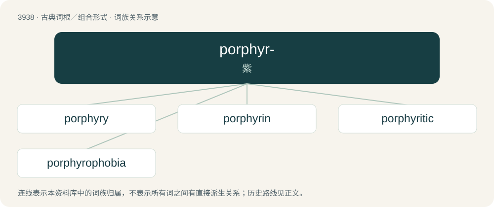

# 3962 · porphyr- — 紫

[总目录](../00_总目录_按常用程度.md)

**类型**：古典词根／组合形式　｜　**来源语言**：古希腊语

## 核心含义与来源

- 核心含义：紫
- 英文含义：purple
- 词形：porphyr-

**来源词形**：πορφύρα (porphúra)

## 词族图

## 单词速览（常用到不常用）

| 单词 | 音标 | 释义 |
|---|---|---|
| [porphyry](#w-1) | /ˈpɔɹ.fɪ.ɹi/ | n. 斑岩；\[医\] 斑岩 |
| [porphyrin](#w-2) | 英 /ˈpɔːfɪɹɪn/；美 /ˈpɔɹfəɹɪn/ | n. 卟啉；\[化\] 卟啉 |
| [porphyritic](#w-3) | /.pɒːfiˈritik/ | a. 斑岩的 |
| [porphyrophobia](#w-4) |  | 【英文】The fear of the color purple. |

## 逐词详解

### 1. porphyry

**词性**：名词　｜　**音标**：/ˈpɔɹ.fɪ.ɹi/

**中文释义**：n. 斑岩；\[医\] 斑岩

**英文义项**：A hard igneous rock consisting of large crystals in a fine-grained matrix. / A purple-red rock of this kind.

**词源与演化**：

From Old French porfire, from Ancient Greek πορφυρίτης λίθος (porphurítēs líthos, “purple stone”), from πορφύρα (porphúra, “purple-fish, purple dye”).

### 2. porphyrin

**词性**：名词　｜　**音标**：英 /ˈpɔːfɪɹɪn/；美 /ˈpɔɹfəɹɪn/

**中文释义**：n. 卟啉；\[化\] 卟啉

**英文义项**：Any of a class of heterocyclic compounds containing pyrrole rings arranged in a square or other similar shape; they are important in biochemistry in a form with a metal atom in the central cavity (hemoglobin with iron, chlorophyll with magnesium, etc.).

**词源与演化**：

From German Porphyrin, shortened from Hämatoporphyrin (“haematoporphyrin”).

### 3. porphyritic

**词性**：形容词　｜　**音标**：/.pɒːfiˈritik/

**中文释义**：a. 斑岩的

**英文义项**：Of or pertaining to porphyry. / Containing large crystals in a fine mass of material.

**构词拆分**：porphyrite + -ic

**词源与演化**：

From porphyrite + -ic.

### 4. porphyrophobia

**词性**：名词

**英文义项**：The fear of the color purple.

**词源与演化**：

From Ancient Greek πορφῠ́ρᾱ (porphŭ́rā, “purple”) + -phobia.
