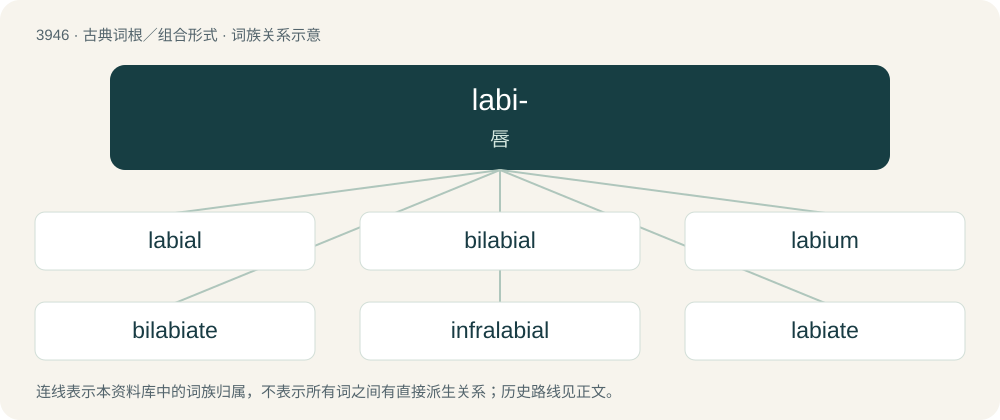

# 3970 · labi- — 唇

[总目录](../00_总目录_按常用程度.md)

**类型**：古典词根／组合形式　｜　**来源语言**：拉丁语

## 核心含义与来源

- 核心含义：唇
- 英文含义：lip
- 词形：labi-

**来源词形**：labia, labiae

## 词族图

## 单词速览（常用到不常用）

| 单词 | 音标 | 释义 |
|---|---|---|
| [labial](#w-1) | /ˈleɪ.bi.əl/ | a. 唇的, 嘴唇的, 唇音的；n. 唇音, 风琴管 |
| [bilabial](#w-2) | /baɪˈleɪ.bi.əl/ | n. 双唇音(如h,m,p等)；a. 有两唇的, 双唇音的 |
| [labium](#w-3) | /ˈleɪ.bi.əm/ | n. 唇, 阴唇, 下唇；\[医\] 唇 |
| [bilabiate](#w-4) | /baiˈleibieit/ | a. 二唇的 |
| [infralabial](#w-5) | /,infrəˈleibiəl/ | a. \[动\]在唇下的 |
| [labiate](#w-6) | /ˈleɪbiət/ | a. 唇形的；n. 唇形科植物 |
| [sublabial](#w-7) | /sʌbˈleibiəl/ | a. \[解\]唇下部的,在唇下的 |
| [supralabial](#w-8) | /ˈsjuːprəˈleibjəl/ | 上唇 |

## 逐词详解

### 1. labial

**词性**：形容词　｜　**音标**：/ˈleɪ.bi.əl/

**中文释义**：a. 唇的, 嘴唇的, 唇音的；n. 唇音, 风琴管

**英文义项**：Of or pertaining to the lips or labia. / Articulated by the lips, as the consonants b, m and w.

**用法示例／搭配（非完整句）**：

> a labial organ pipe

该用例对应义项：Furnished with lips.

### 2. bilabial

**词性**：形容词　｜　**音标**：/baɪˈleɪ.bi.əl/

**中文释义**：n. 双唇音(如h,m,p等)；a. 有两唇的, 双唇音的

**英文义项**：Articulated with both lips.

**构词拆分**：bi- + labial

**词源与演化**：

From bi- + labial.

**例句**：

> When you have a stuffy nose, all your bilabial consonants will sound the same.

### 3. labium

**词性**：名词　｜　**音标**：/ˈleɪ.bi.əm/

**中文释义**：n. 唇, 阴唇, 下唇；\[医\] 唇

**英文义项**：A liplike structure; especially one of the vulva's two pairs of folds of skin on either side. / The lip of a labiate corolla.

**词源与演化**：

Learned borrowing from Latin labium (“a lip”). Doublet of lip.

### 4. bilabiate

**词性**：形容词　｜　**音标**：/baiˈleibieit/

**中文释义**：a. 二唇的

**英文义项**：Having two lips; two-lipped.

**构词拆分**：bi- + labiate

**词源与演化**：

From bi- + labiate.

**例句**：

> The corolla of a snapdragon is bilabiate.

该用例对应义项：having two lips

### 5. infralabial

**词性**：形容词　｜　**音标**：/,infrəˈleibiəl/

**中文释义**：a. \[动\]在唇下的

**英文义项**：Below the lower lip; said of certain scales of reptiles and fishes.

**构词拆分**：infra- + labial

**词源与演化**：

From infra- + labial.

### 6. labiate

**词性**：形容词　｜　**音标**：/ˈleɪbiət/

**中文释义**：a. 唇形的；n. 唇形科植物

**英文义项**：Having lips or liplike parts. / Having the corolla divided into two liplike parts.

### 7. sublabial

**词性**：形容词　｜　**音标**：/sʌbˈleibiəl/

**中文释义**：a. \[解\]唇下部的,在唇下的

**英文义项**：under the lip

**构词拆分**：sub- + labial

**词源与演化**：

From sub- + labial.

### 8. supralabial

**词性**：名词　｜　**音标**：/ˈsjuːprəˈleibjəl/

**中文释义**：上唇

**英文义项**：Any of the scales that border the mouth opening along the upper jaw in reptiles.

**构词拆分**：supra- + labial

**词源与演化**：

From supra- + labial.
