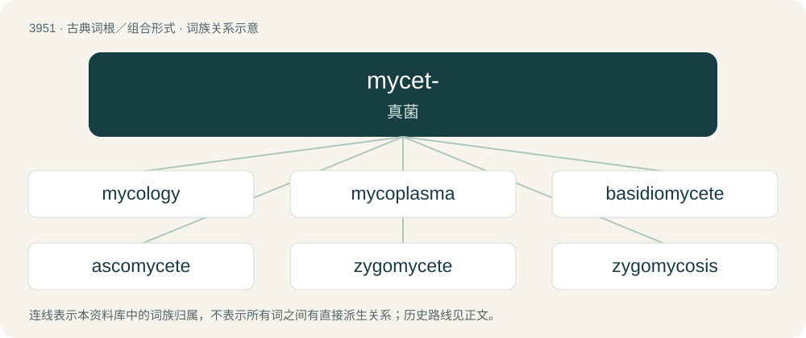

# 3975 · mycet- — 真菌

[总目录](../00_总目录_按常用程度.md)

**类型**：古典词根／组合形式　｜　**来源语言**：古希腊语

## 核心含义与来源

- 核心含义：真菌
- 英文含义：fungus
- 词形：mycet-

**来源词形**：μύκης, μύκητος (múkēs, múkētos)

## 词族图

## 单词速览（常用到不常用）

| 单词 | 音标 | 释义 |
|---|---|---|
| [mycology](#w-1) | 英 /maɪˈkɒ.lə.d͡ʒi/；美 /maɪˈkɑ.lə.d͡ʒi/ | n. 真菌学；\[医\] 真菌学, 霉菌学 |
| [mycoplasma](#w-2) | /,maikəuˈplæzmə/ | n. \[微\]支原体,支原菌 |
| [basidiomycete](#w-3) | /bə.sidiəumaiˈsiːt/ | n. 担子菌 |
| [ascomycete](#w-4) | /.æskəmaiˈsiːt/ | n. 子囊菌 |
| [zygomycete](#w-5) | /zai^əuˈmaisiːt/ | n. 接合菌 |
| [zygomycosis](#w-6) |  | 【英文】An infection caused by bread mold fungi. |

## 逐词详解

### 1. mycology

**词性**：名词　｜　**音标**：英 /maɪˈkɒ.lə.d͡ʒi/；美 /maɪˈkɑ.lə.d͡ʒi/

**中文释义**：n. 真菌学；\[医\] 真菌学, 霉菌学

**英文义项**：The study of fungi.

**词源与演化**：

By surface analysis, myco- + -logy; diachronically, the term may be naturalized from French or German, from a New Latin form.

### 2. mycoplasma

**词性**：名词　｜　**音标**：/,maikəuˈplæzmə/

**中文释义**：n. \[微\]支原体,支原菌

**英文义项**：Any infectious bacterium of the genus Mycoplasma, often specifically Mycoplasma pneumoniae

**构词拆分**：myco- + plasma

**词源与演化**：

From translingual Mycoplasma, from Latin, from Ancient Greek μύκης (múkēs, “fungus”) + πλάσμα (plásma, “-shaped”). Equivalent to myco- + plasma.

### 3. basidiomycete

**词性**：名词　｜　**音标**：/bə.sidiəumaiˈsiːt/

**中文释义**：n. 担子菌

**英文义项**：Any fungus of the phylum Basidiomycota, that produces sexual spores on a basidium.

### 4. ascomycete

**词性**：名词　｜　**音标**：/.æskəmaiˈsiːt/

**中文释义**：n. 子囊菌

**英文义项**：Any fungus of the phylum Ascomycota, characterized by the production of a sac, or ascus, which contains non-motile spores.

**词源与演化**：

From the taxonomic name Ascomycetes (older synonym of Ascomycota) reanalyzed as a plural common noun; by surface analysis, asco- + -mycete.

### 5. zygomycete

**词性**：名词　｜　**音标**：/zai^əuˈmaisiːt/

**中文释义**：n. 接合菌

**英文义项**：An organism of the phylum Zygomycota.

### 6. zygomycosis

**词性**：名词

**英文义项**：An infection caused by bread mold fungi.

**构词拆分**：Zygomycota (“obsolete phylum of fungi”) + -osis

**词源与演化**：

From Zygomycota (“obsolete phylum of fungi”) + -osis.
