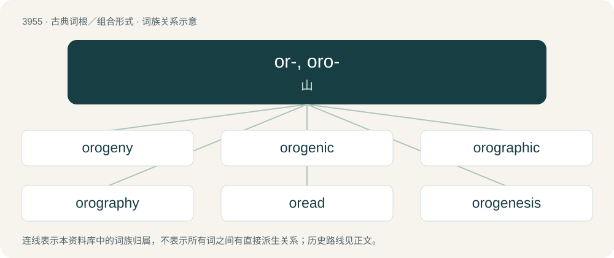

# 3978 · or-, oro- — 山

[总目录](../00_总目录_按常用程度.md)

**类型**：古典词根／组合形式　｜　**来源语言**：古希腊语

## 核心含义与来源

- 核心含义：山
- 英文含义：mountain
- 词形：or-, oro-

**来源词形**：ὄρος, ὄρεος (óros, óreos), ὀρειάς

## 词族图

## 单词速览（常用到不常用）

| 单词 | 音标 | 释义 |
|---|---|---|
| [orogeny](#w-1) | 英 /ɒˈɹɒdʒɪni/ | n. 造山运动, 造山作用 |
| [orogenic](#w-2) | 英 /ɒɹə(ʊ)ˈdʒɛnɪk/ | 切向压缩力的 |
| [orographic](#w-3) | /ˌɒrəˈgræfɪk/ | 地形的, 山岳形态的 |
| [orography](#w-4) | 英 /ɒˈɹɒɡɹəfi/ | n. 山志学, 山岳形态学 |
| [oread](#w-5) | /ˈɔːɹi.æd/ | n. \[希神\]\[罗神\]俄瑞阿得(山岳女神) |
| [orogenesis](#w-6) | /,ɔrəˈdʒenisis/ | n. \[地\] 山岳之形成 |
| [oronym](#w-7) |  | 【英文】The toponym of a mountain. |

## 逐词详解

### 1. orogeny

**词性**：名词　｜　**音标**：英 /ɒˈɹɒdʒɪni/

**中文释义**：n. 造山运动, 造山作用

**英文义项**：The process of mountain building by the upward folding of the Earth's crust.

**词源与演化**：

From French orogénie, from Ancient Greek ὄρος (óros, “mountain, high ground”) + γενεια (geneia, “creation, birth, making”). By surface analysis, oro- + -geny.

### 2. orogenic

**词性**：形容词　｜　**音标**：英 /ɒɹə(ʊ)ˈdʒɛnɪk/

**中文释义**：切向压缩力的

**英文义项**：Concerned with orogeny; pertaining to the creation of mountains.

**构词拆分**：orogeny + -ic

**词源与演化**：

From orogeny + -ic.

### 3. orographic

**词性**：形容词　｜　**音标**：/ˌɒrəˈgræfɪk/

**中文释义**：地形的, 山岳形态的

**英文义项**：Of or pertaining to the physical features of mountains, or to orography. / Of or pertaining to the effects of mountains on weather.

**构词拆分**：orography + -ic

**词源与演化**：

From orography + -ic.

### 4. orography

**词性**：名词　｜　**音标**：英 /ɒˈɹɒɡɹəfi/

**中文释义**：n. 山志学, 山岳形态学

**英文义项**：The scientific study, or a physical description of mountains. / The orographic features of a region.

**构词拆分**：oro- + -graphy

**词源与演化**：

From oro- (“mountain”) + -graphy.

### 5. oread

**词性**：名词　｜　**音标**：/ˈɔːɹi.æd/

**中文释义**：n. \[希神\]\[罗神\]俄瑞阿得(山岳女神)

**英文义项**：A mountain nymph; an anthropomorphic appearance of the spirit of a mountain.

**词源与演化**：

From Latin Orēas, Orēadis, from Ancient Greek Ὀρειάς (Oreiás), from ὄρος (óros, “mountain”).

### 6. orogenesis

**词性**：名词　｜　**音标**：/,ɔrəˈdʒenisis/

**中文释义**：n. \[地\] 山岳之形成

**英文义项**：The process of mountain formation by deformation of the Earth's crust.

**构词拆分**：oro- + -genesis

**词源与演化**：

From oro- + -genesis.

### 7. oronym

**词性**：名词

**英文义项**：The toponym of a mountain.

**构词拆分**：oro- (“of mountains”) + -onym

**词源与演化**：

From oro- (“of mountains”) + -onym.
