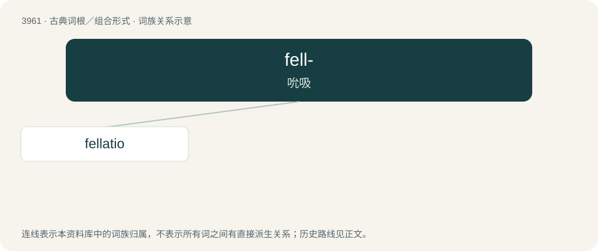

# 3986 · fell- — 吮吸

[总目录](../00_总目录_按常用程度.md)

**类型**：古典词根／组合形式　｜　**来源语言**：拉丁语

## 核心含义与来源

- 核心含义：吮吸
- 英文含义：suck
- 词形：fell-

**来源词形**：fellāre

## 词族图

## 单词速览（常用到不常用）

| 单词 | 音标 | 释义 |
|---|---|---|
| [fellatio](#w-1) | 英 /fəˈleɪ.ʃi.əʊ/；美 /fəˈleɪ.ʃi.oʊ/ | n. 吮吸阴茎；口交 |

## 逐词详解

### 1. fellatio

**词性**：名词　｜　**音标**：英 /fəˈleɪ.ʃi.əʊ/；美 /fəˈleɪ.ʃi.oʊ/

**中文释义**：n. 吮吸阴茎；口交

**英文义项**：Performance of oral sex upon the penis.

**例句**：

> I not only gave him some advice, I also performed fellatio on him.

## 其他候选词

- fellation
