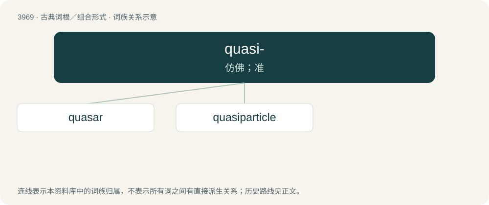

# 3994 · quasi- — 仿佛；准

[总目录](../00_总目录_按常用程度.md)

**类型**：古典词根／组合形式　｜　**来源语言**：拉丁语

## 核心含义与来源

- 核心含义：仿佛；准
- 英文含义：as if, almost
- 词形：quasi-

**来源词形**：quasi

## 词族图

## 单词速览（常用到不常用）

| 单词 | 音标 | 释义 |
|---|---|---|
| [quasar](#w-1) | 英 /ˈkweɪ.zɑː/；美 /ˈkweɪ.zɑɹ/ | n. 类星射电源, 类星体 |
| [quasiparticle](#w-2) | /,kweizaiˈpɑːtikl/ | n. 准粒子 |

## 逐词详解

### 1. quasar

**词性**：名词　｜　**音标**：英 /ˈkweɪ.zɑː/；美 /ˈkweɪ.zɑɹ/

**中文释义**：n. 类星射电源, 类星体

**英文义项**：An extragalactic object, starlike in appearance, that is among the most luminous and (putatively) the most distant objects in the universe.

**词源与演化**：

Blend of quasi- + stellar, from quasi-stellar radio source. Coined by American astrophysicist Hong-Yee Chiu in 1964 in an article in Physics Today. By surface analysis, quasi- + -ar.

### 2. quasiparticle

**词性**：名词　｜　**音标**：/,kweizaiˈpɑːtikl/

**中文释义**：n. 准粒子

**英文义项**：Any entity that has some characteristics of a distinct particle, but comprises a grouping of multiple particles

**构词拆分**：quasi- + particle

**词源与演化**：

From quasi- + particle.
