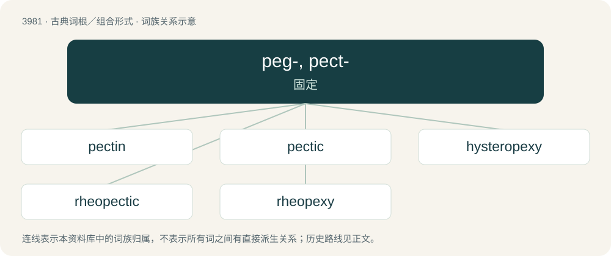

# 4002 · peg-, pect- — 固定

[总目录](../00_总目录_按常用程度.md)

**类型**：古典词根／组合形式　｜　**来源语言**：古希腊语

## 核心含义与来源

- 核心含义：固定
- 英文含义：fix
- 词形：peg-, pect-

**来源词形**：πηγνύναι (pēgnúnai), πηκτός (pēktós), πηκτικός (pēktikós), πῆξις (pêxis), πῆγμα (pêgma), πάγη (págē), πάγος (págos), πάγιος (págios), παγιότης (pagiótēs), πάσσαλος (pássalos)

## 词族图

## 单词速览（常用到不常用）

| 单词 | 音标 | 释义 |
|---|---|---|
| [pectin](#w-1) | /ˈpɛktɪn/ | n. 果胶；\[化\] 果胶 |
| [pectic](#w-2) | /ˈpektik/ | a. 果胶的, 粘胶质的 |
| [hysteropexy](#w-3) | /,histəˈrɔpeksi/ | 子宫固定术 |
| [rheopectic](#w-4) | /,riːəˈpektik/ | (=rheopexic) 震凝的, 抗流变的, 流凝的 |
| [rheopexy](#w-5) | /ˈriːə,peksi/ | 震凝性, 抗流变性, 流凝性 |

## 逐词详解

### 1. pectin

**词性**：名词　｜　**音标**：/ˈpɛktɪn/

**中文释义**：n. 果胶；\[化\] 果胶

**英文义项**：A plant-derived polysaccharide found in cell walls (especially in fruits) that forms a gel under acidic conditions and is commonly used to thicken foods like jam and jellies.

**词源与演化**：

From French pectine, coined in the 1830s by Henri Braconnot, from acide pectique "pectic acid", from Ancient Greek πηκτικός (pēktikós, “curdling”), from πηκτός (pēktós, “curdled”), from πήγνυμι (pḗgnumi, “stiffen”).

**例句**：

> Apple is rich in pectin and so is often added to other fruits when making jam so it will set.

该用例对应义项：A plant-derived polysaccharide found in cell walls (especially in fruits) that forms a gel under acidic conditions and is commonly used to thicken foods like jam and jellies.

### 2. pectic

**词性**：形容词　｜　**音标**：/ˈpektik/

**中文释义**：a. 果胶的, 粘胶质的

**英文义项**：Of or pertaining to pectin or pectin-like substances. / Relating to pectic acid or its derivatives.

**构词拆分**：pectin + -ic

**词源与演化**：

From pectin + -ic, from Ancient Greek πηκτικός (pēktikós, “curdling”), from πηκτός (pēktós, “curdled”), from πήγνυμι (pḗgnumi, “stiffen”).

### 3. hysteropexy

**词性**：名词　｜　**音标**：/,histəˈrɔpeksi/

**中文释义**：子宫固定术

**英文义项**：The fixation of a misplaced or abnormally movable uterus.

**构词拆分**：hystero- + -pexy

**词源与演化**：

From hystero- + -pexy.

### 4. rheopectic

**词性**：形容词　｜　**音标**：/,riːəˈpektik/

**中文释义**：(=rheopexic) 震凝的, 抗流变的, 流凝的

**英文义项**：Exhibiting rheopexy.

**构词拆分**：rheopecty + -ic

**词源与演化**：

From rheopecty + -ic.

### 5. rheopexy

**词性**：名词　｜　**音标**：/ˈriːə,peksi/

**中文释义**：震凝性, 抗流变性, 流凝性

**英文义项**：A rheological phenomenon in which certain colloids solidify more quickly when subjected to shear

**构词拆分**：rheo- (“current”) + -pexy (“fixing (in place)”)

**词源与演化**：

From rheo- (“current”) + -pexy (“fixing (in place)”).

## 其他候选词

- pagophobia
- parapagus
- rheopecty
