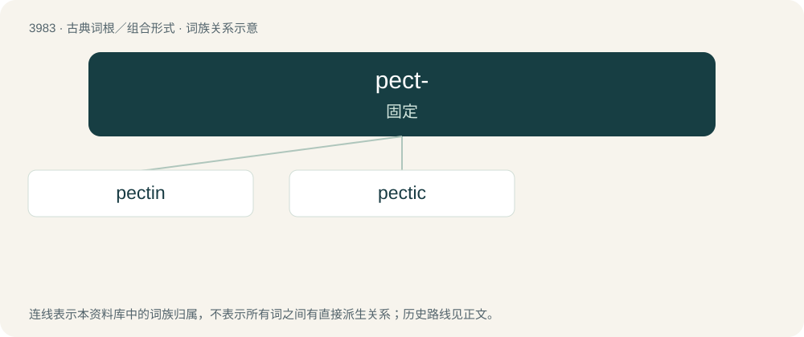

# 4006 · pect- — 固定

[总目录](../00_总目录_按常用程度.md)

**类型**：古典词根／组合形式　｜　**来源语言**：古希腊语

## 核心含义与来源

- 核心含义：固定
- 英文含义：fixed
- 词形：pect-

**来源词形**：πηκτός (pēktós)

## 词族图

## 单词速览（常用到不常用）

| 单词 | 音标 | 释义 |
|---|---|---|
| [pectin](#w-1) | /ˈpɛktɪn/ | n. 果胶；\[化\] 果胶 |
| [pectic](#w-2) | /ˈpektik/ | a. 果胶的, 粘胶质的 |

## 逐词详解

### 1. pectin

**词性**：名词　｜　**音标**：/ˈpɛktɪn/

**中文释义**：n. 果胶；\[化\] 果胶

**英文义项**：A plant-derived polysaccharide found in cell walls (especially in fruits) that forms a gel under acidic conditions and is commonly used to thicken foods like jam and jellies.

**词源与演化**：

From French pectine, coined in the 1830s by Henri Braconnot, from acide pectique "pectic acid", from Ancient Greek πηκτικός (pēktikós, “curdling”), from πηκτός (pēktós, “curdled”), from πήγνυμι (pḗgnumi, “stiffen”).

**例句**：

> Apple is rich in pectin and so is often added to other fruits when making jam so it will set.

该用例对应义项：A plant-derived polysaccharide found in cell walls (especially in fruits) that forms a gel under acidic conditions and is commonly used to thicken foods like jam and jellies.

### 2. pectic

**词性**：形容词　｜　**音标**：/ˈpektik/

**中文释义**：a. 果胶的, 粘胶质的

**英文义项**：Of or pertaining to pectin or pectin-like substances. / Relating to pectic acid or its derivatives.

**构词拆分**：pectin + -ic

**词源与演化**：

From pectin + -ic, from Ancient Greek πηκτικός (pēktikós, “curdling”), from πηκτός (pēktós, “curdled”), from πήγνυμι (pḗgnumi, “stiffen”).
