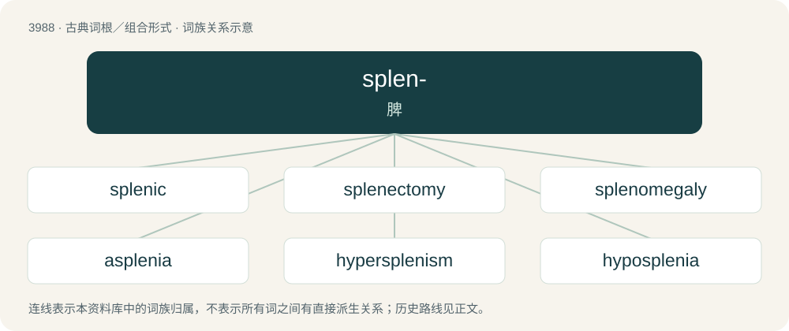

# 4011 · splen- — 脾

[总目录](../00_总目录_按常用程度.md)

**类型**：古典词根／组合形式　｜　**来源语言**：古希腊语

## 核心含义与来源

- 核心含义：脾
- 英文含义：spleen
- 词形：splen-

**来源词形**：σπλήν (splḗn), splēnikós

## 词族图

## 单词速览（常用到不常用）

| 单词 | 音标 | 释义 |
|---|---|---|
| [splenic](#w-1) | 英 /ˈspliːnɪk/；美 /ˈsplinɪk/ | a. 脾脏的, 脾的；\[医\] 脾的 |
| [splenectomy](#w-2) | /spliˈnektəmi/ | n. 脾切除术；\[医\] 脾切除术 |
| [splenomegaly](#w-3) | /,spliːnəˈme^əli, splenə-/ | n. 脾大, 脾肿大；\[医\] 脾大 |
| [asplenia](#w-4) |  | \[医\] 无脾 |
| [hypersplenism](#w-5) |  | \[医\] 脾机能亢进 |
| [hyposplenia](#w-6) |  | 【英文】Synonym of hyposplenism. |
| [polysplenia](#w-7) |  | 【英文】A congenital disease manifested by multiple small accessory spleens. |
| [splenitis](#w-8) | /spliˈnaitis/ | n. 脾炎；\[医\] 脾炎 |
| [splenoid](#w-9) | /ˈspliːnɔid/ | a. 脾样的；\[医\] 脾样的 |

## 逐词详解

### 1. splenic

**词性**：形容词　｜　**音标**：英 /ˈspliːnɪk/；美 /ˈsplinɪk/

**中文释义**：a. 脾脏的, 脾的；\[医\] 脾的

**英文义项**：Of, related to, or located near the spleen.

**词源与演化**：

From Latin splēnicus, from Ancient Greek σπληνικός (splēnikós, “of the spleen”). By surface analysis, splen- + -ic.

### 2. splenectomy

**词性**：名词　｜　**音标**：/spliˈnektəmi/

**中文释义**：n. 脾切除术；\[医\] 脾切除术

**英文义项**：The surgical removal of the spleen.

**词源与演化**：

From Ancient Greek σπλήν (splḗn, “spleen”) + -ectomy.

### 3. splenomegaly

**词性**：名词　｜　**音标**：/,spliːnəˈme^əli, splenə-/

**中文释义**：n. 脾大, 脾肿大；\[医\] 脾大

**英文义项**：Enlargement of the spleen (process); an enlargement of the spleen (instance).

**构词拆分**：spleno- + -megaly

**词源与演化**：

From spleno- + -megaly.

### 4. asplenia

**词性**：名词

**中文释义**：\[医\] 无脾

**英文义项**：Anatomical absence of the spleen (after splenectomy or congenitally). / Physiological absence of splenic function; either substantial or total splenic dysfunction; splenic nonfunction.

**构词拆分**：a- + splen- + -ia

**词源与演化**：

From a- + splen- + -ia.

### 5. hypersplenism

**词性**：名词

**中文释义**：\[医\] 脾机能亢进

**英文义项**：A disorder in which abnormal spleen activity destroys blood cells.

**词源与演化**：

By surface analysis, hyper- + splen- + -ism.

### 6. hyposplenia

**词性**：名词

**英文义项**：Synonym of hyposplenism.

### 7. polysplenia

**词性**：名词

**英文义项**：A congenital disease manifested by multiple small accessory spleens.

### 8. splenitis

**词性**：名词　｜　**音标**：/spliˈnaitis/

**中文释义**：n. 脾炎；\[医\] 脾炎

**英文义项**：Inflammation of the spleen.

**构词拆分**：splen- + -itis

**词源与演化**：

From splen- + -itis.

### 9. splenoid

**词性**：形容词　｜　**音标**：/ˈspliːnɔid/

**中文释义**：a. 脾样的；\[医\] 脾样的

**英文义项**：Of, related to, or resembling the spleen.

**词源与演化**：

From Ancient Greek σπλήν (splḗn, “spleen”) + -oid.

**用法示例／搭配（非完整句）**：

> splenoid metaplasia

该用例对应义项：Of, related to, or resembling the spleen.
