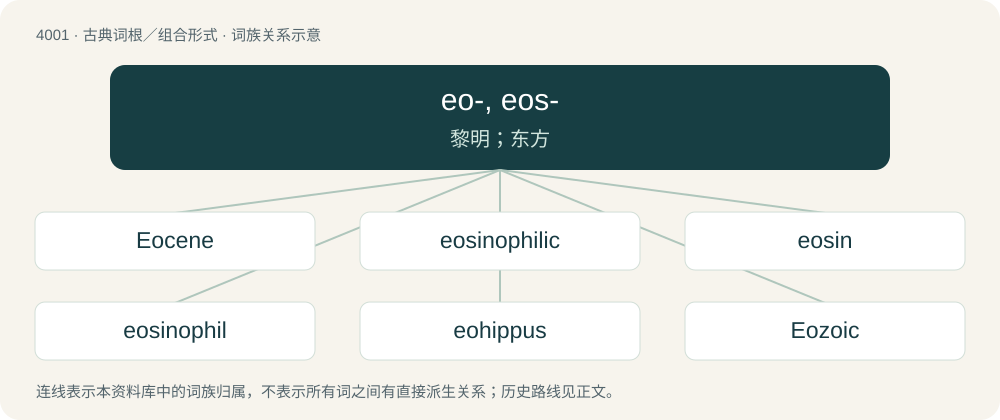

# 4022 · eo-, eos- — 黎明；东方

[总目录](../00_总目录_按常用程度.md)

**类型**：古典词根／组合形式　｜　**来源语言**：古希腊语

## 核心含义与来源

- 核心含义：黎明；东方
- 英文含义：dawn, east
- 词形：eo-, eos-

**来源词形**：Ἠώς, Ἕως (Ēṓs, Héōs)

## 词族图

## 单词速览（常用到不常用）

| 单词 | 音标 | 释义 |
|---|---|---|
| [Eocene](#w-1) | /ˈiːəsiːn/ | n. 始新世, 始新系；a. 始新世的, 始新系的 |
| [eosinophilic](#w-2) | /-ˈfilik/ | \[医\] 嗜曙红的, 嗜酸性的 |
| [eosin](#w-3) | /ˈi.əsɪn/ | n. 曙红色染料；\[化\] 曙红; 酸性曙红; 四溴荧光素 |
| [eosinophil](#w-4) | /i.əˈsɪnəˌfɪl/ | \[医\] 嗜曙红细胞, 嗜酸性细胞 |
| [eohippus](#w-5) | /ˈiːəʊˌhɪpəs/ | n. 始祖鸟 |
| [Eozoic](#w-6) | /iːəˈzəuik/ | n. 始生代；a. 始生代的 |

## 逐词详解

### 1. Eocene

**词性**：形容词　｜　**音标**：/ˈiːəsiːn/

**中文释义**：n. 始新世, 始新系；a. 始新世的, 始新系的

**英文义项**：Of a geologic epoch within the Paleogene period from about 56 to 34 million years ago.

**词源与演化**：

From Ancient Greek ἠώς (ēṓs, “dawn”) + καινός (kainós, “new”) and refers to the "dawn" of modern ('new') fauna that appeared during the epoch. Coined by English polymath William Whewell in 1831 for Charles Lyell, who introduced it in 1833 in his book Principles of Geology. By surface analysis, eo- + -cene.

### 2. eosinophilic

**词性**：形容词　｜　**音标**：/-ˈfilik/

**中文释义**：\[医\] 嗜曙红的, 嗜酸性的

**英文义项**：That is readily stained with eosin. / Of, pertaining to an eosinophil or to eosinophilia.

**构词拆分**：eosin + -o- + -philic

**词源与演化**：

From eosin + -o- + -philic.

### 3. eosin

**词性**：名词　｜　**音标**：/ˈi.əsɪn/

**中文释义**：n. 曙红色染料；\[化\] 曙红; 酸性曙红; 四溴荧光素

**英文义项**：A red, acidic dye commonly used in histological stains.

**词源与演化**：

Borrowed from German Eosin, coined by Heinrich Caro, from Ancient Greek ἠώς (ēṓs, “dawn”) + -in.

**例句**：

> A biopsy specimen was obtained and sent to Pathology where it was sectioned and stained with hematoxylin and eosin.

### 4. eosinophil

**词性**：名词　｜　**音标**：/i.əˈsɪnəˌfɪl/

**中文释义**：\[医\] 嗜曙红细胞, 嗜酸性细胞

**英文义项**：A white blood cell responsible for combating parasitic infections in the body.

**构词拆分**：eosin (“rose dye, from Ancient Greek ἠώς (ēṓs, “dawn”) + -in”) + -o- + -phil

**词源与演化**：

From German eosinophil, from eosin (“rose dye, from Ancient Greek ἠώς (ēṓs, “dawn”) + -in”) + -o- + -phil.

### 5. eohippus

**词性**：名词　｜　**音标**：/ˈiːəʊˌhɪpəs/

**中文释义**：n. 始祖鸟

**英文义项**：An extinct early Eocene mammal (Hyracotherium leporinum), ancestral to the modern horse.

**词源与演化**：

Originally a genus name, Eohippus, formed in New Latin, from Ancient Greek ἠώς (ēṓs, “dawn”) + ἵππος (híppos, “horse”). By surface analysis, eo- + Latin hippus.

### 6. Eozoic

**词性**：形容词　｜　**音标**：/iːəˈzəuik/

**中文释义**：n. 始生代；a. 始生代的

**英文义项**：Precambrian, or more specifically Archaean.

**构词拆分**：eo- + -zoic

**词源与演化**：

eo- + -zoic

## 其他候选词

- Eosentomon
