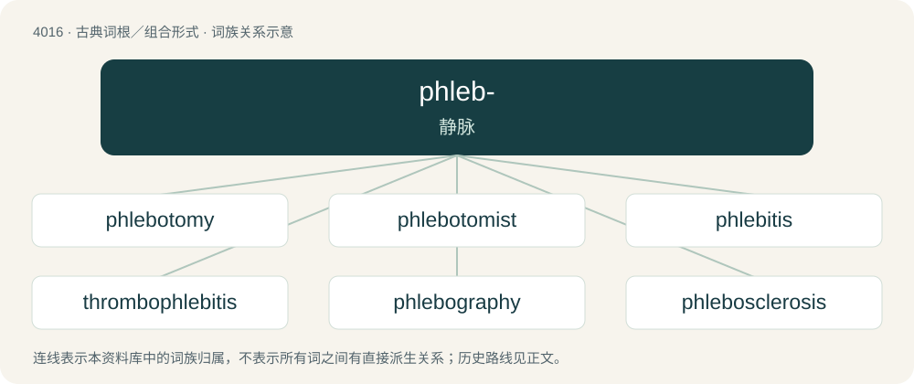

# 4033 · phleb- — 静脉

[总目录](../00_总目录_按常用程度.md)

**类型**：古典词根／组合形式　｜　**来源语言**：古希腊语

## 核心含义与来源

- 核心含义：静脉
- 英文含义：vein
- 词形：phleb-

**来源词形**：φλέψ, φλεβός (phléps, phlebós), φλέβιον

## 词族图

## 单词速览（常用到不常用）

| 单词 | 音标 | 释义 |
|---|---|---|
| [phlebotomy](#w-1) | 英 /flɪˈbɒtəmi/；美 /flɪˈbɑtəmi/ | n. 静脉切开术, 放血术；\[医\] 静脉切开术, 放血术 |
| [phlebotomist](#w-2) | /fliˈbɔtəmist/ | n. 刺络医师, 抽血者 |
| [phlebitis](#w-3) | /flɪˈbaɪtɪs/ | n. 静脉炎；\[医\] 静脉炎 |
| [thrombophlebitis](#w-4) | /,θrɔmbəufliˈbaitis/ | \[医\] 血栓静脉炎 |
| [phlebography](#w-5) | /fliˈbɔ^rəfi/ | n. \[医\]静脉造影术, 静脉搏动描记法 |
| [phlebosclerosis](#w-6) | /,flebəuskliəˈrəusis/ | n. 静脉硬化；\[医\] 静脉硬化 |
| [phlebotomize](#w-7) | /fliˈbɔtəmaiz/ | v. 抽静脉血, 抽血 |

## 逐词详解

### 1. phlebotomy

**词性**：名词　｜　**音标**：英 /flɪˈbɒtəmi/；美 /flɪˈbɑtəmi/

**中文释义**：n. 静脉切开术, 放血术；\[医\] 静脉切开术, 放血术

**英文义项**：The opening of a vein, either to withdraw blood or for letting blood; venesection.

**词源与演化**：

From Old French flebothomie (French phlébotomie), from Late Latin phlebotomia, from Ancient Greek φλεβοτόμος (phlebotómos, “that opens a vein”), from φλέψ (phléps, “vein”). By surface analysis, phlebo- + -tomy.

### 2. phlebotomist

**词性**：名词　｜　**音标**：/fliˈbɔtəmist/

**中文释义**：n. 刺络医师, 抽血者

**英文义项**：A practitioner of phlebotomy.

**构词拆分**：phlebotomy + -ist

**词源与演化**：

From phlebotomy + -ist.

**例句**：

> The phlebotomist scared herself by practicing her craft on a balloon.

### 3. phlebitis

**词性**：名词　｜　**音标**：/flɪˈbaɪtɪs/

**中文释义**：n. 静脉炎；\[医\] 静脉炎

**英文义项**：Inflammation of a vein, usually in the legs.

**构词拆分**：phleb(o)- + -itis

**词源与演化**：

From phleb(o)- + -itis.

**例句**：

> Phlebitis is caused by enlarged veins near the surface of the skin.

### 4. thrombophlebitis

**词性**：名词　｜　**音标**：/,θrɔmbəufliˈbaitis/

**中文释义**：\[医\] 血栓静脉炎

**英文义项**：Phlebitis related to a blood clot or thrombus.

**构词拆分**：thrombo- + phlebitis

**词源与演化**：

From thrombo- + phlebitis.

### 5. phlebography

**词性**：名词　｜　**音标**：/fliˈbɔ^rəfi/

**中文释义**：n. \[医\]静脉造影术, 静脉搏动描记法

**英文义项**：An X-ray examination of a system of veins that have been injected with a contrast medium.

**构词拆分**：phlebo- + -graphy

**词源与演化**：

From phlebo- + -graphy.

### 6. phlebosclerosis

**词性**：名词　｜　**音标**：/,flebəuskliəˈrəusis/

**中文释义**：n. 静脉硬化；\[医\] 静脉硬化

**英文义项**：sclerosis of the wall of a vein

**构词拆分**：phlebo- + sclerosis

**词源与演化**：

From phlebo- + sclerosis.

### 7. phlebotomize

**词性**：动词　｜　**音标**：/fliˈbɔtəmaiz/

**中文释义**：v. 抽静脉血, 抽血

**英文义项**：To perform a phlebotomy on (a vein): to open (a vein) to withdraw or let blood. / To perform a phlebotomy on (a person): to open a vein of (a person) to withdraw or let blood.

**构词拆分**：phlebotomy + -ize

**词源与演化**：

From phlebotomy + -ize.
