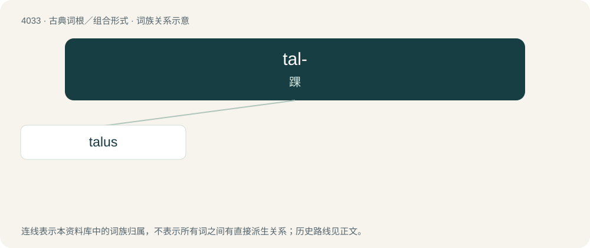

# 4048 · tal- — 踝

[总目录](../00_总目录_按常用程度.md)

**类型**：古典词根／组合形式　｜　**来源语言**：拉丁语

## 核心含义与来源

- 核心含义：踝
- 英文含义：ankle
- 词形：tal-

**来源词形**：talus

## 词族图

## 单词速览（常用到不常用）

| 单词 | 音标 | 释义 |
|---|---|---|
| [talus](#w-1) | /ˈteɪləs/ | n. 距骨, 踝, 斜面；\[医\] 距骨 |

## 逐词详解

### 1. talus

**词性**：名词　｜　**音标**：/ˈteɪləs/

**中文释义**：n. 距骨, 踝, 斜面；\[医\] 距骨

**英文义项**：The bone of the ankle.

**词源与演化**：

Borrowed from Latin tālus.
