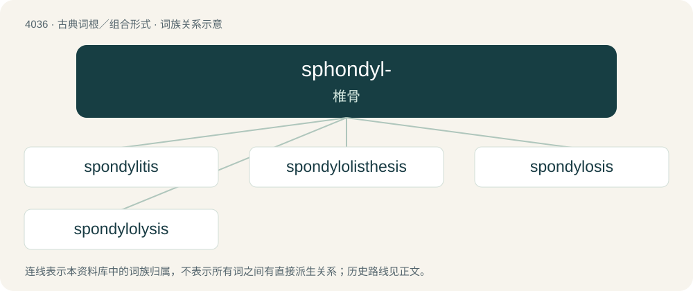

# 4051 · sphondyl- — 椎骨

[总目录](../00_总目录_按常用程度.md)

**类型**：古典词根／组合形式　｜　**来源语言**：古希腊语

## 核心含义与来源

- 核心含义：椎骨
- 英文含义：vertebra
- 词形：sphondyl-

**来源词形**：σφόνδυλος, σφονδύλου (sphóndulos, sphondúlou)

## 词族图

## 单词速览（常用到不常用）

| 单词 | 音标 | 释义 |
|---|---|---|
| [spondylitis](#w-1) | /.spɒndiˈlaitis/ | n. 脊椎炎；\[医\] 脊椎炎 |
| [spondylolisthesis](#w-2) | /ˌspɒn.dɪˌlo.lɪsˈθiːsɪs/ | n. \[医\]脊椎前移 |
| [spondylosis](#w-3) | /ˌspɒndɪˈləʊsɪs/ | 椎关节强硬 |
| [spondylolysis](#w-4) | /spɔndiˈlɔlisis/ | 椎骨脱离 |

## 逐词详解

### 1. spondylitis

**词性**：名词　｜　**音标**：/.spɒndiˈlaitis/

**中文释义**：n. 脊椎炎；\[医\] 脊椎炎

**英文义项**：Inflammation of the spine.

**词源与演化**：

Latin spondylus (“vertebra”) + -itis

### 2. spondylolisthesis

**词性**：名词　｜　**音标**：/ˌspɒn.dɪˌlo.lɪsˈθiːsɪs/

**中文释义**：n. \[医\]脊椎前移

**英文义项**：A forward displacement of a vertebra over a lower vertebra, due to a congenital defect or injury.

**构词拆分**：spondylo- (“spine”) + Ancient Greek ὀλισθάνω (olisthánō, “to slip, slide”) + -esis

**词源与演化**：

From Latin spondylolisthesis, equivalent to spondylo- (“spine”) + Ancient Greek ὀλισθάνω (olisthánō, “to slip, slide”) + -esis.

### 3. spondylosis

**词性**：名词　｜　**音标**：/ˌspɒndɪˈləʊsɪs/

**中文释义**：椎关节强硬

**英文义项**：A degenerative disease in which the vertebral joints of the spine become stiff and then fused.

**构词拆分**：spondyl- + -osis

**词源与演化**：

From spondyl- + -osis.

### 4. spondylolysis

**词性**：名词　｜　**音标**：/spɔndiˈlɔlisis/

**中文释义**：椎骨脱离

**英文义项**：A defect or stress fracture of the pars interarticularis of the vertebral arch.

**构词拆分**：spondylo- + -lysis

**词源与演化**：

From spondylo- + -lysis.

## 其他候选词

- Temnospondyli
