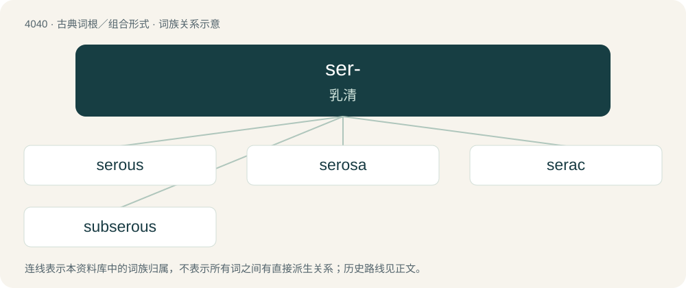

# 4055 · ser- — 乳清

[总目录](../00_总目录_按常用程度.md)

**类型**：古典词根／组合形式　｜　**来源语言**：拉丁语

## 核心含义与来源

- 核心含义：乳清
- 英文含义：whey
- 词形：ser-

**来源词形**：serum

## 词族图

## 单词速览（常用到不常用）

| 单词 | 音标 | 释义 |
|---|---|---|
| [serous](#w-1) | /ˈsɪərəs/ | a. 如水的, 浆液的, 血清的；\[医\] 血清的; 浆液的 |
| [serosa](#w-2) | /sɪˈɹəʊ.sə/ | \[动\]浆膜, 绒(毛)膜 |
| [serac](#w-3) | 英 /sɛˈɹæk/；美 /sɛˈɹæk/ | n. 冰塔 |
| [subserous](#w-4) | /sʌbˈsiərəs/ | a. \[解\]浆膜下的 |

## 逐词详解

### 1. serous

**词性**：形容词　｜　**音标**：/ˈsɪərəs/

**中文释义**：a. 如水的, 浆液的, 血清的；\[医\] 血清的; 浆液的

**英文义项**：Containing, secreting, or resembling serum; watery; a fluid or discharge that is pale yellow and transparent, usually representing something of a benign nature. (This contrasts with sanguine, which means blood-tinged and usually harmful.)

**词源与演化**：

From French séreux, from Latin serosus, from serum.

### 2. serosa

**词性**：名词　｜　**音标**：/sɪˈɹəʊ.sə/

**中文释义**：\[动\]浆膜, 绒(毛)膜

**英文义项**：Synonym of serous membrane.

### 3. serac

**词性**：名词　｜　**音标**：英 /sɛˈɹæk/；美 /sɛˈɹæk/

**中文释义**：n. 冰塔

**英文义项**：Often sérac: a hard, cone-shaped, pale green, strongly flavoured cheese from Switzerland made from skimmed cow milk and blue fenugreek (Trigonella caerulea); Schabziger, Sapsago. It is usually eaten grated, mixed with butter, or in a fondue. / A sharp tower of ice formed by intersecting crevasses of a glacier.

**词源与演化**：

From Swiss French sérac (“kind of cheese; sharp tower of ice”), from Franco-Provençal sera, seré, from Latin seraceum, from serum (“whey”), from Proto-Indo-European \*ser- (“to flow, run”). Sense 2 is from the resemblance of the towers of ice to the cheese, which tends to cleave into rectangular pieces.

### 4. subserous

**词性**：形容词　｜　**音标**：/sʌbˈsiərəs/

**中文释义**：a. \[解\]浆膜下的

**英文义项**：Situated under a serous membrane. / Somewhat serous or watery.

**构词拆分**：sub- + serous

**词源与演化**：

From sub- + serous.

**用法示例／搭配（非完整句）**：

> subserous myoma

该用例对应义项：Situated under a serous membrane.
