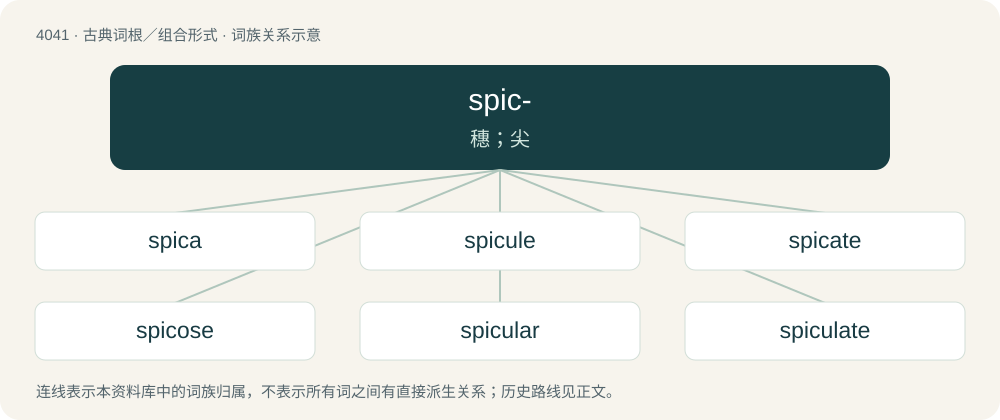

# 4057 · spic- — 穗；尖

[总目录](../00_总目录_按常用程度.md)

**类型**：古典词根／组合形式　｜　**来源语言**：拉丁语

## 核心含义与来源

- 核心含义：穗；尖
- 英文含义：spike
- 词形：spic-

**来源词形**：spica

## 词族图

## 单词速览（常用到不常用）

| 单词 | 音标 | 释义 |
|---|---|---|
| [spica](#w-1) | /spik/ | n. 穗状花序, 人字形绷带, 角宿一；\[医\] 人字形绷带; 穗状花序 |
| [spicule](#w-2) | /ˈspikjuːl/ | n. 针状体, 小穗, 空壳, 骨针；\[医\] 针, 刺; 交合刺 |
| [spicate](#w-3) | /ˈspaɪkeɪt/ | a. 排列成穗的, 穗状花序的 |
| [spicose](#w-4) | 英 /ˈspaɪkəʊs/；美 /ˈspaɪˌkoʊs/ | a. \[植\]有穗的 |
| [spicular](#w-5) |  | \[医\] 针的, 刺的 |
| [spiculate](#w-6) | /ˈspikjuːleit/ | a. 针状的, 尖锐的, 有骨针的 |
| [spiculiform](#w-7) | /spɪkˈjuːlɪfɔːm/ | \[医\]穗状的, 针形 |

## 逐词详解

### 1. spica

**词性**：名词　｜　**音标**：/spik/

**中文释义**：n. 穗状花序, 人字形绷带, 角宿一；\[医\] 人字形绷带; 穗状花序

**英文义项**：A spike (kind of inflorescence in which sessile flowers are arranged on an unbranched elongated axis). / A spur.

### 2. spicule

**词性**：名词　｜　**音标**：/ˈspikjuːl/

**中文释义**：n. 针状体, 小穗, 空壳, 骨针；\[医\] 针, 刺; 交合刺

**英文义项**：A sharp, needle-like piece. / A tiny glass flake formed during the manufacture of glass vials.

**词源与演化**：

From Latin spīculum.

### 3. spicate

**词性**：形容词　｜　**音标**：/ˈspaɪkeɪt/

**中文释义**：a. 排列成穗的, 穗状花序的

**英文义项**：Having the form of a spike, or ear; arranged in a spike or spikes.

**词源与演化**：

From Latin spicatus, past participle of spicare (“to furnish with spikes, or ears”).

### 4. spicose

**词性**：形容词　｜　**音标**：英 /ˈspaɪkəʊs/；美 /ˈspaɪˌkoʊs/

**中文释义**：a. \[植\]有穗的

**英文义项**：Having spikes or ears

**构词拆分**：Latin spīca (“spike, ear of grain”) + -ose

**词源与演化**：

From Latin spīca (“spike, ear of grain”) + -ose.

**用法示例／搭配（非完整句）**：

> a spicose umbel

该用例对应义项：Having spikes or ears

### 5. spicular

**词性**：形容词

**中文释义**：\[医\] 针的, 刺的

**英文义项**：Of, pertaining to, or formed from spicules, spiculum, or spicula.

**构词拆分**：spicule + -ar；spiculum + -ar；spicula + -ar

**词源与演化**：

From spicule + -ar, spiculum + -ar, and spicula + -ar

### 6. spiculate

**词性**：形容词　｜　**音标**：/ˈspikjuːleit/

**中文释义**：a. 针状的, 尖锐的, 有骨针的

**英文义项**：Covered with, or having, spicules.

**词源与演化**：

From Latin spiculatus.

### 7. spiculiform

**词性**：形容词　｜　**音标**：/spɪkˈjuːlɪfɔːm/

**中文释义**：\[医\]穗状的, 针形

**英文义项**：Having the shape of a spicule.

**构词拆分**：spicule + -iform

**词源与演化**：

From spicule + -iform.

**用法示例／搭配（非完整句）**：

> spiculiform organs

该用例对应义项：Having the shape of a spicule.

## 其他候选词

- spicosity
