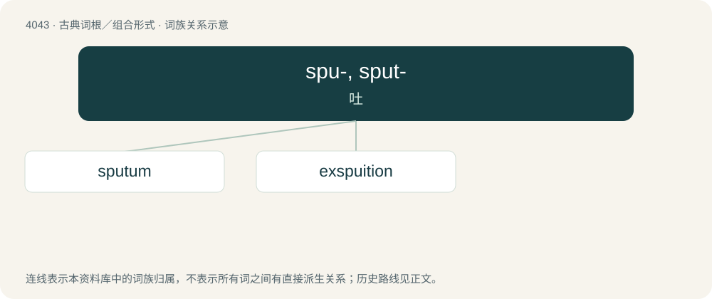

# 4059 · spu-, sput- — 吐

[总目录](../00_总目录_按常用程度.md)

**类型**：古典词根／组合形式　｜　**来源语言**：拉丁语

## 核心含义与来源

- 核心含义：吐
- 英文含义：spew, spit
- 词形：spu-, sput-

**来源词形**：spuere

## 词族图

## 单词速览（常用到不常用）

| 单词 | 音标 | 释义 |
|---|---|---|
| [sputum](#w-1) | /ˈspjutəm/ | n. 唾液, 痰 |
| [exspuition](#w-2) |  | 【英文】The act of spitting. |

## 逐词详解

### 1. sputum

**词性**：名词　｜　**音标**：/ˈspjutəm/

**中文释义**：n. 唾液, 痰

**英文义项**：Matter coughed up and expectorated from the mouth, composed of saliva and discharges from the respiratory passages such as mucus, phlegm or pus.

**词源与演化**：

From New Latin, from Latin sputum (“that which is spit out, spittle”), from spuere (“to spit”).

**例句**：

> Finding TB in young children, in particular, poses a hurdle because youngsters often can’t produce a sputum sample necessary to diagnose the disease.

### 2. exspuition

**词性**：名词

**英文义项**：The act of spitting.

**词源与演化**：

Borrowed from Latin \[Term?\].
