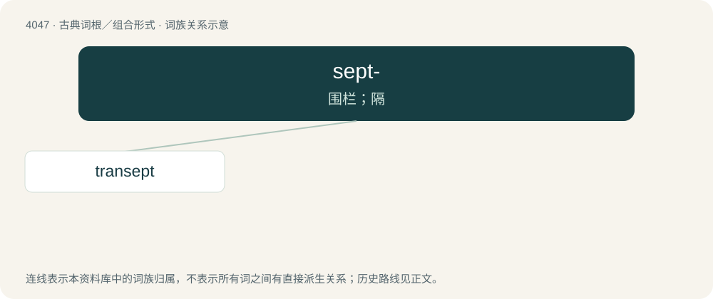

# 4062 · sept- — 围栏；隔

[总目录](../00_总目录_按常用程度.md)

**类型**：古典词根／组合形式　｜　**来源语言**：拉丁语

## 核心含义与来源

- 核心含义：围栏；隔
- 英文含义：fence, partition, enclosure
- 词形：sept-

**来源词形**：saeptum

## 词族图

## 单词速览（常用到不常用）

| 单词 | 音标 | 释义 |
|---|---|---|
| [transept](#w-1) | /ˈtɹænsɛpt/ | n. 交叉甬道 |

## 逐词详解

### 1. transept

**词性**：名词　｜　**音标**：/ˈtɹænsɛpt/

**中文释义**：n. 交叉甬道

**英文义项**：The transversal part of a church, which crosses at right angles to the greatest length, and between the nave and choir. In the basilicas, this had often no projection at its two ends. In Gothic churches these project greatly, and should be called the arms of the transept. It is common, however, to speak of the arms themselves as the transepts.

**词源与演化**：

From French transept, from New Latin transeptum, from Latin trans- (“across”) + saeptum (“fence, partition, enclosure”).

**例句**：

> The nave, transept and aisles of the church have marble floors.
