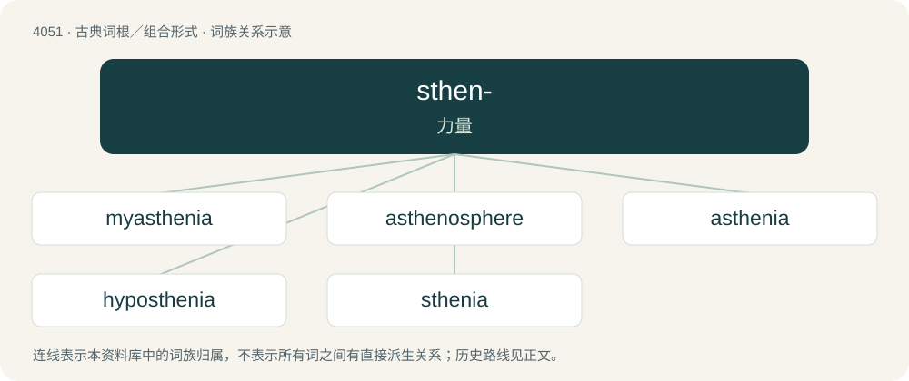

# 4065 · sthen- — 力量

[总目录](../00_总目录_按常用程度.md)

**类型**：古典词根／组合形式　｜　**来源语言**：古希腊语

## 核心含义与来源

- 核心含义：力量
- 英文含义：strength
- 词形：sthen-

**来源词形**：σθένος (sthénos)

## 词族图

## 单词速览（常用到不常用）

| 单词 | 音标 | 释义 |
|---|---|---|
| [myasthenia](#w-1) | /ˈmaiæsˈθiːniə/ | n. 肌无力, 肌衰弱；\[医\] 肌无力, 肌衰弱 |
| [asthenosphere](#w-2) | 英 /asˈθɛnə(ʊ)sfɪə/ | n. 软流圈 |
| [asthenia](#w-3) | 英 /æsˈθiː.nɪə/；美 /æsˈθi.ni.ə/ | n. 衰弱；\[医\] 无力, 虚弱, 衰弱 |
| [hyposthenia](#w-4) | /,haipɔsˈθiːniə/ | n. 衰弱, 无力 |
| [sthenia](#w-5) | 英 /ˈsθiːniə/；美 /ˈsθiniə/ | 强壮, 有力 |

## 逐词详解

### 1. myasthenia

**词性**：名词　｜　**音标**：/ˈmaiæsˈθiːniə/

**中文释义**：n. 肌无力, 肌衰弱；\[医\] 肌无力, 肌衰弱

**英文义项**：Abnormal weakness of the muscles; but especially myasthenia gravis.

**构词拆分**：my- (“relating to muscle”) + asthenia (“weakness”)

**词源与演化**：

From my- (“relating to muscle”) + asthenia (“weakness”), from Ancient Greek ἀσθένεια (asthéneia, “weakness”). By surface analysis, my- (“muscle”) + a- (“not”) + sthen- (“strength”) + -ia (“disease”).

### 2. asthenosphere

**词性**：名词　｜　**音标**：英 /asˈθɛnə(ʊ)sfɪə/

**中文释义**：n. 软流圈

**英文义项**：A portion of the Earth's upper mantle, below the lithosphere.

**构词拆分**：astheno- + -sphere

**词源与演化**：

From astheno- + -sphere.

### 3. asthenia

**词性**：名词　｜　**音标**：英 /æsˈθiː.nɪə/；美 /æsˈθi.ni.ə/

**中文释义**：n. 衰弱；\[医\] 无力, 虚弱, 衰弱

**英文义项**：Weakness; loss of strength. / weakness

**词源与演化**：

From Ancient Greek ἀσθένεια (asthéneia), from ἀσθενής (asthenḗs, “sick, weak”), from ἀ- (a-, “not, un-”) + σθένος (sthénos, “strength”). By surface analysis, a- (“not”) + sthen- (“strength”) + -ia (“disease”).

**例句**：

> The most commonly reported flu symptoms are fever, chills, sweating, asthenia, headache and nausea.

### 4. hyposthenia

**词性**：名词　｜　**音标**：/,haipɔsˈθiːniə/

**中文释义**：n. 衰弱, 无力

**英文义项**：weakness; subnormal strength

**词源与演化**：

From Ancient Greek ὑπό (hupó, “under”) + σθένος (sthénos, “strength”) + -ia.

### 5. sthenia

**词性**：名词　｜　**音标**：英 /ˈsθiːniə/；美 /ˈsθiniə/

**中文释义**：强壮, 有力

**英文义项**：strength, vigour or vitality

**词源与演化**：

Back-formation from asthenia.

## 其他候选词

- callisthenics
- sthène
