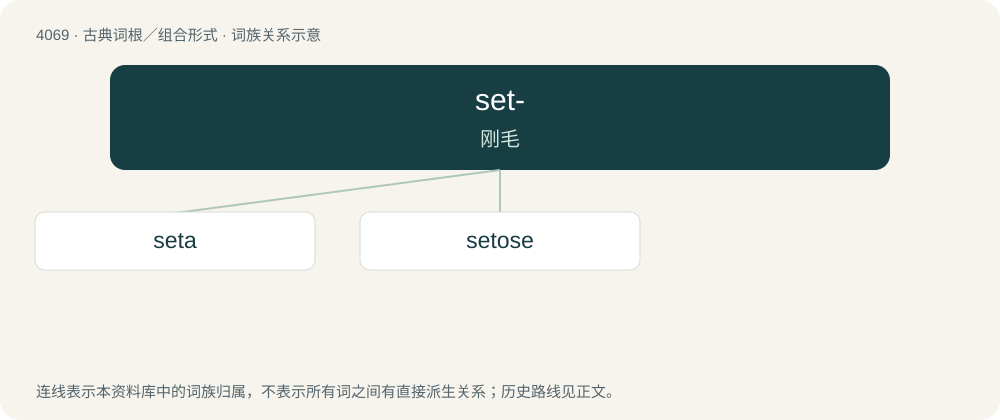

# 4083 · set- — 刚毛

[总目录](../00_总目录_按常用程度.md)

**类型**：古典词根／组合形式　｜　**来源语言**：拉丁语

## 核心含义与来源

- 核心含义：刚毛
- 英文含义：bristle, hair
- 词形：set-

**来源词形**：saeta

## 词族图

## 单词速览（常用到不常用）

| 单词 | 音标 | 释义 |
|---|---|---|
| [seta](#w-1) | /ˈsiːtə/ | n. 刚毛；\[医\] 鬃, 刚毛 |
| [setose](#w-2) | /ˈsiːtəus/ | a. 多刚毛的 |

## 逐词详解

### 1. seta

**词性**：名词　｜　**音标**：/ˈsiːtə/

**中文释义**：n. 刚毛；\[医\] 鬃, 刚毛

**英文义项**：A bristle or hair. / The stalk of a moss sporangium, or occasionally in a liverwort.

**词源与演化**：

From Latin seta, from saeta. Doublet of soy (“silk”).

### 2. setose

**词性**：形容词　｜　**音标**：/ˈsiːtəus/

**中文释义**：a. 多刚毛的

**英文义项**：Thickly set with bristles or bristly hairs.

**词源与演化**：

Latin setosus, saetosus, from seta (“bristle”), saeta (“bristle”).
