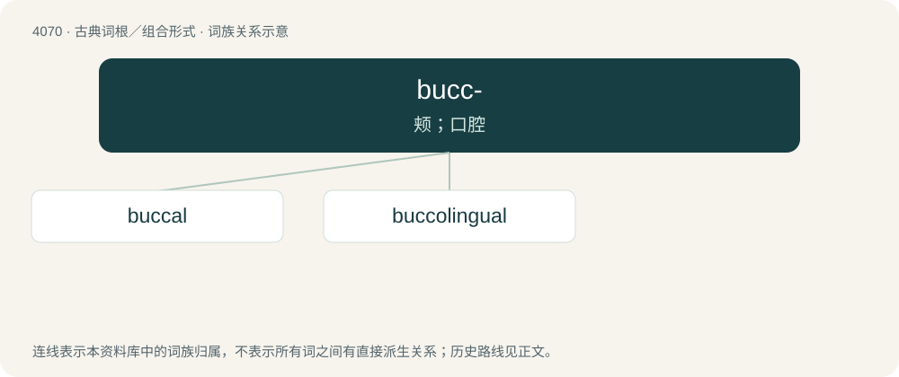

# 4084 · bucc- — 颊；口腔

[总目录](../00_总目录_按常用程度.md)

**类型**：古典词根／组合形式　｜　**来源语言**：拉丁语

## 核心含义与来源

- 核心含义：颊；口腔
- 英文含义：cheek, mouth, cavity
- 词形：bucc-

**来源词形**：bucca

## 词族图

## 单词速览（常用到不常用）

| 单词 | 音标 | 释义 |
|---|---|---|
| [buccal](#w-1) | /ˈbʌkəl/ | a. 颊的, 口的, 口腔的；\[医\] 颊的 |
| [buccolingual](#w-2) | /ˌbʌkoʊˈlɪŋɡwəl/ | a. \[解\]颊舌的 |

## 逐词详解

### 1. buccal

**词性**：形容词　｜　**音标**：/ˈbʌkəl/

**中文释义**：a. 颊的, 口的, 口腔的；\[医\] 颊的

**英文义项**：Of, relating to, near, involving, or supplying the cheek. / Of, relating to, or lying in the mouth.

**构词拆分**：Latin bucca (“the cheek”) + -al

**词源与演化**：

From Latin bucca (“the cheek”) + -al. By surface analysis, bucc- + -al.

**用法示例／搭配（非完整句）**：

> buccal branch of the facial nerve

该用例对应义项：Of, relating to, near, involving, or supplying the cheek.

### 2. buccolingual

**词性**：形容词　｜　**音标**：/ˌbʌkoʊˈlɪŋɡwəl/

**中文释义**：a. \[解\]颊舌的

**英文义项**：Of or pertaining to the cheek and the tongue. / In a location on the buccal and lingual aspect (of a tooth or its socket).

**构词拆分**：bucco- + lingual

**词源与演化**：

From bucco- + lingual.

## 其他候选词

- buccilingual
