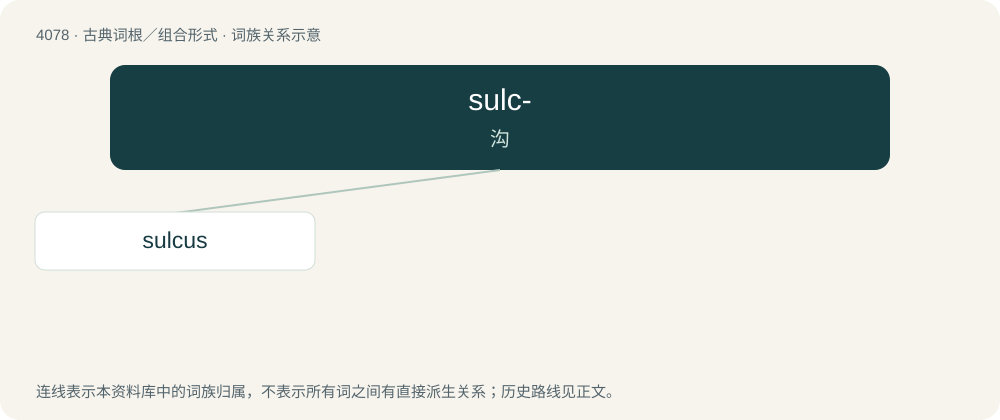

# 4091 · sulc- — 沟

[总目录](../00_总目录_按常用程度.md)

**类型**：古典词根／组合形式　｜　**来源语言**：拉丁语

## 核心含义与来源

- 核心含义：沟
- 英文含义：furrow
- 词形：sulc-

**来源词形**：sulcus

## 词族图

## 单词速览（常用到不常用）

| 单词 | 音标 | 释义 |
|---|---|---|
| [sulcus](#w-1) | /ˈsʌl.kəs/ | \[医\] 沟 |

## 逐词详解

### 1. sulcus

**词性**：名词　｜　**音标**：/ˈsʌl.kəs/

**中文释义**：\[医\] 沟

**英文义项**：A furrow or groove in an organ or a tissue, especially that marking the convolutions of the surface of the brain. / A region of subparallel grooves or ditches formed by a geological process.

**词源与演化**：

Borrowed from Latin sulcus (“a furrow made by a plow”). Doublet of sullow ("plough").
