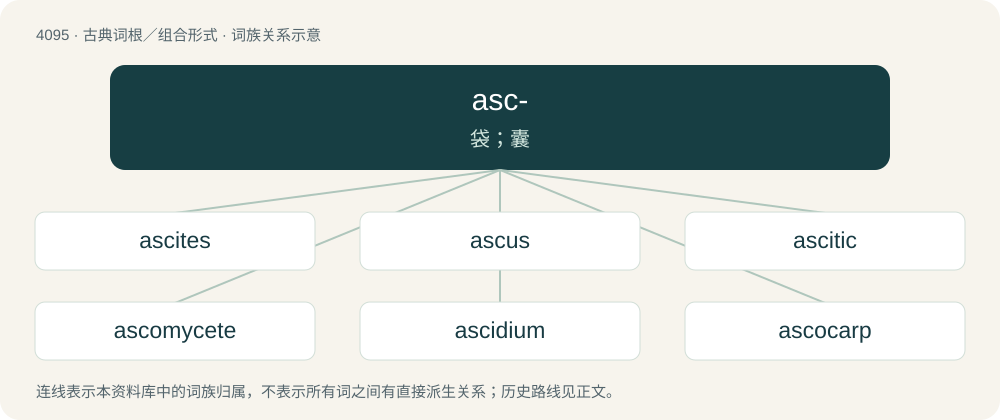

# 4104 · asc- — 袋；囊

[总目录](../00_总目录_按常用程度.md)

**类型**：古典词根／组合形式　｜　**来源语言**：古希腊语

## 核心含义与来源

- 核心含义：袋；囊
- 英文含义：bag
- 词形：asc-

**来源词形**：ἀσκός (askós), ἀσκίδιον (askídion)

## 词族图

## 单词速览（常用到不常用）

| 单词 | 音标 | 释义 |
|---|---|---|
| [ascites](#w-1) | /əˈsaɪtiːz/ | n. 腹水；\[医\] 腹水 |
| [ascus](#w-2) | /ˈæskəs/ | n. 子囊；\[医\] 子囊 |
| [ascitic](#w-3) | /əˈsɪtɪk/ | \[医\] 腹水的 |
| [ascomycete](#w-4) | /.æskəmaiˈsiːt/ | n. 子囊菌 |
| [ascidium](#w-5) | /əˈsidiəm/ | n. 瓶子状器官, 囊状器官 |
| [ascocarp](#w-6) | /ˈæskəukɑːp/ | n. \[植\]子囊果 |
| [ascoma](#w-7) |  | 子囊座 |
| [ascospore](#w-8) | /ˈæskəuspɔː/ | n. \[植\]囊孢子 |

## 逐词详解

### 1. ascites

**词性**：名词　｜　**音标**：/əˈsaɪtiːz/

**中文释义**：n. 腹水；\[医\] 腹水

**英文义项**：An accumulation of fluid in the peritoneal cavity, frequently symptomatic of liver disease.

**词源与演化**：

From Latin ascītēs, borrowed from Ancient Greek ἀσκίτης (askítēs), from ἀσκός (askós, “wineskin”).

### 2. ascus

**词性**：名词　｜　**音标**：/ˈæskəs/

**中文释义**：n. 子囊；\[医\] 子囊

**英文义项**：A sac-shaped cell present in ascomycete fungi; it is a reproductive cell in which meiosis and an additional cell division produce eight spores.

**词源与演化**：

From New Latin ascus, from Ancient Greek ἀσκός (askós, “a sac”). Doublet of askos.

### 3. ascitic

**词性**：形容词　｜　**音标**：/əˈsɪtɪk/

**中文释义**：\[医\] 腹水的

**英文义项**：Of, pertaining to, or suffering from ascites

**构词拆分**：ascites + -ic

**词源与演化**：

From ascites + -ic.

### 4. ascomycete

**词性**：名词　｜　**音标**：/.æskəmaiˈsiːt/

**中文释义**：n. 子囊菌

**英文义项**：Any fungus of the phylum Ascomycota, characterized by the production of a sac, or ascus, which contains non-motile spores.

**词源与演化**：

From the taxonomic name Ascomycetes (older synonym of Ascomycota) reanalyzed as a plural common noun; by surface analysis, asco- + -mycete.

### 5. ascidium

**词性**：名词　｜　**音标**：/əˈsidiəm/

**中文释义**：n. 瓶子状器官, 囊状器官

**英文义项**：A pitcher-shaped or flask-shaped organ or appendage of a plant. / One of the former genus Ascidium of simple ascidians, which included most of the known species; sometimes used as a name for the family Ascidiidae or for all the Tunicata, or Ascidiacea.

**词源与演化**：

From New Latin ascidium, from Ancient Greek ἀσκίδιον (askídion), from ἀσκός (askós, “leather bag”) + -ιδιον (-idion, “diminutive ending”).

### 6. ascocarp

**词性**：名词　｜　**音标**：/ˈæskəukɑːp/

**中文释义**：n. \[植\]子囊果

**英文义项**：The sporocarp of an ascomycete, typically bowl-shaped.

**词源与演化**：

By surface analysis, asco- + carp.

### 7. ascoma

**词性**：名词

**中文释义**：子囊座

**英文义项**：An ascocarp.

**词源与演化**：

By surface analysis, asco- + -oma.

### 8. ascospore

**词性**：名词　｜　**音标**：/ˈæskəuspɔː/

**中文释义**：n. \[植\]囊孢子

**英文义项**：A sexually produced spore from the ascus of an Ascomycetes fungus

**词源与演化**：

By surface analysis, asco- + spore.

## 其他候选词

- Ascomycota
