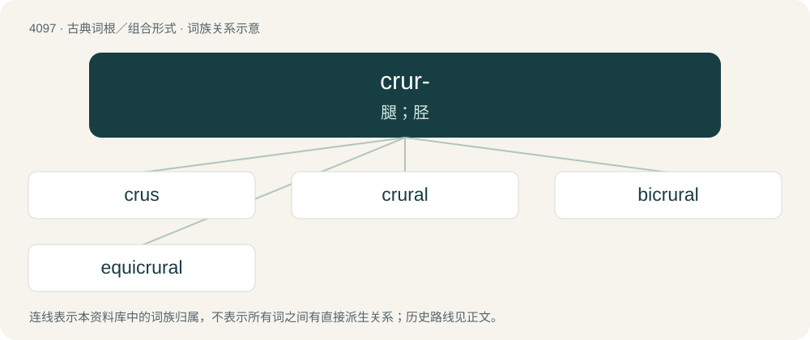

# 4107 · crur- — 腿；胫

[总目录](../00_总目录_按常用程度.md)

**类型**：古典词根／组合形式　｜　**来源语言**：拉丁语

## 核心含义与来源

- 核心含义：腿；胫
- 英文含义：leg, shank
- 词形：crur-

**来源词形**：crus, cruris

## 词族图

## 单词速览（常用到不常用）

| 单词 | 音标 | 释义 |
|---|---|---|
| [crus](#w-1) | /krʌs/ | n. 腿, 下肢；\[医\] 脚 |
| [crural](#w-2) | 英 /ˈkɹʊəɹəl/ | a. 腿的, 一双腿似的；\[医\] 脚的 |
| [bicrural](#w-3) | 英 /ˌbaɪˈkɹʊəɹəl/；美 /ˌbaɪˈkɹʊɹ.əl/ | a. 双腿的；\[医\] 两腿的, 两脚的 |
| [equicrural](#w-4) | /iːkwɪˈkɹʊəɹəl/ | 等腰的 |

## 逐词详解

### 1. crus

**词性**：名词　｜　**音标**：/krʌs/

**中文释义**：n. 腿, 下肢；\[医\] 脚

**英文义项**：The shin (tibia and fibula) / A leglike part; shank

**词源与演化**：

Borrowed from Latin crūs.

### 2. crural

**词性**：形容词　｜　**音标**：英 /ˈkɹʊəɹəl/

**中文释义**：a. 腿的, 一双腿似的；\[医\] 脚的

**英文义项**：Pertaining to the leg. / Leg-like in shape or constitution.

**词源与演化**：

From Latin crūrālis, from crūs (“leg”) (stem: crūr-). By surface analysis, crur- + -al.

### 3. bicrural

**词性**：形容词　｜　**音标**：英 /ˌbaɪˈkɹʊəɹəl/；美 /ˌbaɪˈkɹʊɹ.əl/

**中文释义**：a. 双腿的；\[医\] 两腿的, 两脚的

**英文义项**：having two legs

**构词拆分**：bi- + crural

**词源与演化**：

From bi- + crural.

### 4. equicrural

**词性**：形容词　｜　**音标**：/iːkwɪˈkɹʊəɹəl/

**中文释义**：等腰的

**英文义项**：Having legs of equal size; isosceles.

**词源与演化**：

From Latin aequicrurus, + -al.
