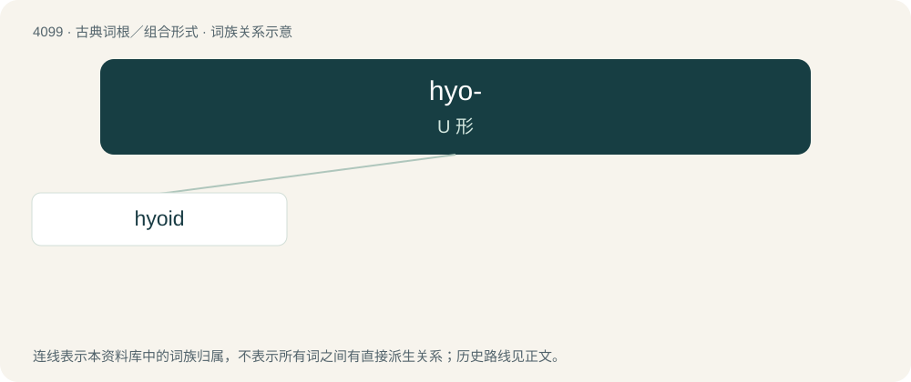

# 4110 · hyo- — U 形

[总目录](../00_总目录_按常用程度.md)

**类型**：古典词根／组合形式　｜　**来源语言**：古希腊语

## 核心含义与来源

- 核心含义：U 形
- 英文含义：U-shaped
- 词形：hyo-

**来源词形**：ὑοειδής (huoeidḗs)

## 词族图

## 单词速览（常用到不常用）

| 单词 | 音标 | 释义 |
|---|---|---|
| [hyoid](#w-1) | /ˈhaɪ.ɔɪd/ | a. 舌骨的；n. 舌骨 |

## 逐词详解

### 1. hyoid

**词性**：形容词　｜　**音标**：/ˈhaɪ.ɔɪd/

**中文释义**：a. 舌骨的；n. 舌骨

**英文义项**：Shaped like a U, or like the letter upsilon (υ). / Of or pertaining to the hyoid bone.

**例句**：

> This stick has a hyoid shape.

该用例对应义项：Shaped like a U, or like the letter upsilon (υ).

## 其他候选词

- hyostyly
