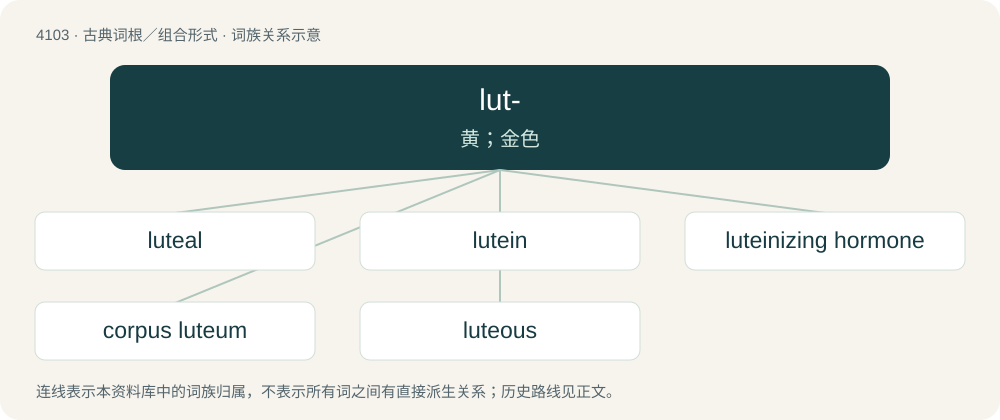

# 4113 · lut- — 黄；金色

[总目录](../00_总目录_按常用程度.md)

**类型**：古典词根／组合形式　｜　**来源语言**：拉丁语

## 核心含义与来源

- 核心含义：黄；金色
- 英文含义：yellow, golden
- 词形：lut-

**来源词形**：lūtum, lūteus

## 词族图

## 单词速览（常用到不常用）

| 单词 | 音标 | 释义 |
|---|---|---|
| [luteal](#w-1) | /ˈluːtiəl/ | a. \[生化\]黄体的 |
| [lutein](#w-2) | /ˈluːtiin/ | n. 叶黄素；\[医\] 黄体素, 脂色素 |
| [luteinizing hormone](#w-3) |  | \[化\] 促黄体(生成)激素；\[医\] 黄体化激素 |
| [corpus luteum](#w-4) |  | \[建\] 黄体 |
| [luteous](#w-5) | 英 /ˈluːtiəs/；美 /ˈludiəs/ | a. 略带绿色之黄金色的 |

## 逐词详解

### 1. luteal

**词性**：形容词　｜　**音标**：/ˈluːtiəl/

**中文释义**：a. \[生化\]黄体的

**英文义项**：Of or pertaining to the corpus luteum.

**构词拆分**：From luteum + -al.

**词源与演化**：

From luteum + -al.

### 2. lutein

**词性**：名词　｜　**音标**：/ˈluːtiin/

**中文释义**：n. 叶黄素；\[医\] 黄体素, 脂色素

**英文义项**：A yellow carotenoid pigment, widely distributed in both plants and animals.

**词源与演化**：

From Latin luteus (“yellow”) + English -in.

### 3. luteinizing hormone

**词性**：名词

**中文释义**：\[化\] 促黄体(生成)激素；\[医\] 黄体化激素

**英文义项**：A hormone, produced by anterior part of the pituitary gland, that stimulates ovulation and the development of the corpus luteum in female mammals, and the production of androgens by male mammals.

**词源与演化**：

“Luteinizing” is derived from Latin luteus (“yellow”). The luteinizing hormone stimulates the development of the corpus luteum (literally “yellow body”), which is yellow in colour.

### 4. corpus luteum

**词性**：名词

**中文释义**：\[建\] 黄体

**英文义项**：A yellow mass of cells that forms from an ovarian follicle during the luteal phase of the menstrual cycle in mammals; it secretes steroid hormones.

**词源与演化**：

From Latin corpus (“body”) + lūteum (“yellow”).

### 5. luteous

**词性**：形容词　｜　**音标**：英 /ˈluːtiəs/；美 /ˈludiəs/

**中文释义**：a. 略带绿色之黄金色的

**英文义项**：Yellowish. / Of or pertaining to mud.

**词源与演化**：

Borrowed from Latin lūteus.
