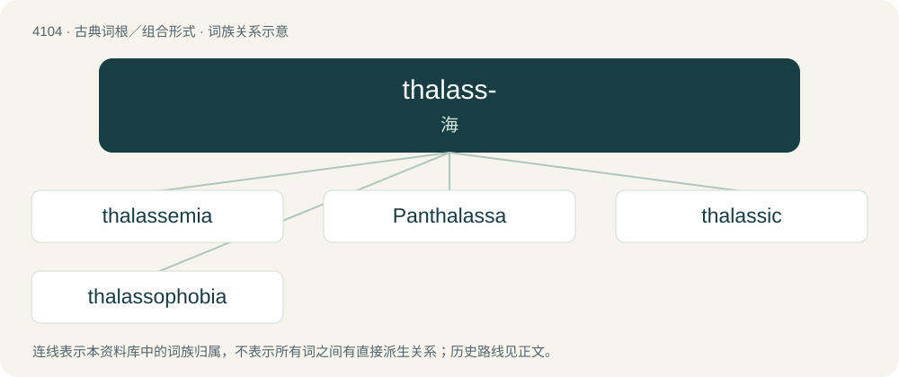

# 4115 · thalass- — 海

[总目录](../00_总目录_按常用程度.md)

**类型**：古典词根／组合形式　｜　**来源语言**：古希腊语

## 核心含义与来源

- 核心含义：海
- 英文含义：sea
- 词形：thalass-

**来源词形**：θάλασσα (thálassa)

## 词族图

## 单词速览（常用到不常用）

| 单词 | 音标 | 释义 |
|---|---|---|
| [thalassemia](#w-1) | /ˌθæləˈsiːmiə/ | \[医\] 地中海贫血, 库利氏贫血 |
| [Panthalassa](#w-2) | /,pænθəˈlæsə/ | 泛古洋 |
| [thalassic](#w-3) | /θəˈlæsik/ | a. 海的, 海湾的, 内海的 |
| [thalassophobia](#w-4) | 英 /θəˌlæ.səʊˈfəʊ.bi.ə/；美 /θəˌlæ.soʊˈfoʊ.bi.ə/ | \[医\] 海洋恐怖 |

## 逐词详解

### 1. thalassemia

**词性**：名词　｜　**音标**：/ˌθæləˈsiːmiə/

**中文释义**：\[医\] 地中海贫血, 库利氏贫血

**英文义项**：Any of a group of inherited disorders in which the amount of hemoglobin in the blood is reduced.

**词源与演化**：

From Ancient Greek θάλασσα (thálassa, “sea”) (see also thalass-) and -emia (“blood”) (from αἷμα (haîma)). The etymology is suggestive of the epidemiology of the disorder, which is more common in people of Mediterranean descent. First attested in 1932.

### 2. Panthalassa

**词性**：专有名词　｜　**音标**：/,pænθəˈlæsə/

**中文释义**：泛古洋

**英文义项**：The prehistoric ocean surrounding Pangaea.

**构词拆分**：pan- + Ancient Greek θάλασσα (thálassa, “sea”)

**词源与演化**：

From pan- + Ancient Greek θάλασσα (thálassa, “sea”).

### 3. thalassic

**词性**：形容词　｜　**音标**：/θəˈlæsik/

**中文释义**：a. 海的, 海湾的, 内海的

**英文义项**：of or relating to seas and oceans / pelagic

**词源与演化**：

From French thalassique, from Ancient Greek θάλασσα (thálassa, “sea”) + -ique.

**例句**：

> Deposits of sediment in gulfs and seas rather than in the ocean proper are known as thalassic deposits.

该用例对应义项：relating to the seas, especially smaller or inland seas

### 4. thalassophobia

**词性**：名词　｜　**音标**：英 /θəˌlæ.səʊˈfəʊ.bi.ə/；美 /θəˌlæ.soʊˈfoʊ.bi.ə/

**中文释义**：\[医\] 海洋恐怖

**英文义项**：A morbid fear of the sea or, more generally, deep, large bodies of water such as lakes.

**构词拆分**：thalasso- + -phobia

**词源与演化**：

From thalasso- + -phobia.

**例句**：

> No, Tom doesn't have thalassophobia. He just pretends to.
