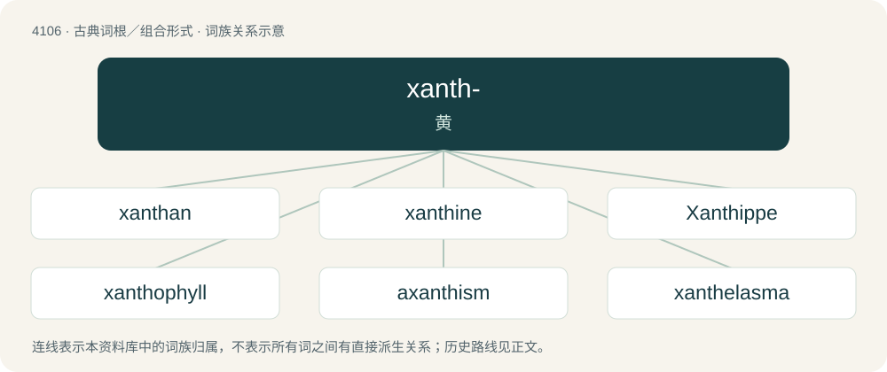

# 4117 · xanth- — 黄

[总目录](../00_总目录_按常用程度.md)

**类型**：古典词根／组合形式　｜　**来源语言**：古希腊语

## 核心含义与来源

- 核心含义：黄
- 英文含义：yellow
- 词形：xanth-

**来源词形**：ξανθός (xanthós), ξανθότης (xanthótēs) "yellowness"

## 词族图

## 单词速览（常用到不常用）

| 单词 | 音标 | 释义 |
|---|---|---|
| [xanthan](#w-1) | /ˈzænθən/ | n. 黄原胶（增稠剂和稳定剂在食品工业, 医学和药学领域） |
| [xanthine](#w-2) | 英 /ˈzanθiːn/；美 /ˈzænθin/ | n. 黄质, 黄嘌呤；\[化\] 黄嘌呤 |
| [Xanthippe](#w-3) | 英 /zænˈθɪpi/ | n. 粘西比(苏格拉底之妻), 悍妇 |
| [xanthophyll](#w-4) |  | \[医\] 叶黄素 |
| [axanthism](#w-5) |  | 【英文】Absence of yellow pigmentation. |
| [xanthelasma](#w-6) | /zænθɪˈlæzmə/ | \[医\]黄斑瘤 |
| [xanthic](#w-7) | /ˈzænθɪk/ | a. 黄色的, 黄嘌呤的, 带黄色的；\[医\] 黄色的, 黄嘌呤的 |
| [xanthochromia](#w-8) |  | \[医\] 黄变(脑脊液或皮肤) |
| [xanthochromism](#w-9) | /ˌzænθəˈkɹəʊmɪzəm/ | 【英文】Abnormal yellow colouration. |
| [xanthogenic](#w-10) |  | 黄酸盐的 |
| [xanthoma](#w-11) | 美 /zænˈθoʊmə/ | n. 黄瘤, 黄疣, 黄色瘤；\[医\] 黄瘤 |
| [xanthomatosis](#w-12) | /zæn,θəuməˈtəusis/ | n. \[医\]黄瘤症 |
| [xanthophobia](#w-13) | 美 /zæn.θəˈfoʊ.bi.ə/ | 【英文】Fear of the colour yellow. |
| [xanthophore](#w-14) | /ˈzænθə,fɔː/ | n. \[生\]黄色素细胞 |
| [xanthopsia](#w-15) | /zænˈθɔpsiə/ | n. 黄幻视, 视物显黄症, 黄视症；\[医\] 黄视症 |
| [xanthopterin](#w-16) | /zænˈθɔptərin/ | 黄蝶呤, 2-氨基-4, 6-二羟基蝶呤 |
| [xanthosis](#w-17) | 美 /zænˈθoʊsɪs/ | n. 黄肤症, 黄变病 |
| [xanthous](#w-18) | 英 /ˈzæn.θəs/ | a. 黄色的, 黄色人种的, 蒙古人种的；\[医\] 黄的, 黄色的 |

## 逐词详解

### 1. xanthan

**词性**：名词　｜　**音标**：/ˈzænθən/

**中文释义**：n. 黄原胶（增稠剂和稳定剂在食品工业, 医学和药学领域）

**英文义项**：A polysaccharide, consisting of galactose and mannose residues, produced by the bacterium Xanthomonas campestris

### 2. xanthine

**词性**：名词　｜　**音标**：英 /ˈzanθiːn/；美 /ˈzænθin/

**中文释义**：n. 黄质, 黄嘌呤；\[化\] 黄嘌呤

**英文义项**：Any of a group of alkaloids that include caffeine, theophylline, and theobromine as well as the parent compound, a precursor of uric acid found in many organs of the body.

**构词拆分**：xanth- + -ine

**词源与演化**：

From international scientific vocabulary, from French xanthine, reflecting New Latin combining forms: xanth- + -ine; ultimately from Ancient Greek ξανθός (xanthós, “yellow”), because xanthine is yellowish-white. By surface analysis, xanth- + -ine.

### 3. Xanthippe

**词性**：名词　｜　**音标**：英 /zænˈθɪpi/

**中文释义**：n. 粘西比(苏格拉底之妻), 悍妇

**英文义项**：An ill-tempered woman.

**词源与演化**：

Borrowed from Latin Xanthippē or its etymon Ancient Greek Ξανθίππη (Xanthíppē), the name of Socrates’ wife, from ξανθός (xanthós, “blond; golden, yellow”) (ultimately from Proto-Indo-European \*ḱas- (“blond; grey; white”)) + ἵππος (híppos, “horse”) (ultimately from Proto-Indo-European \*h₁eḱ- (“horse; swift (?)”)). She is described as shrewish in Xenophon’s Symposium, though the same work states that Socrates chose her precisely because of her argumentative spirit. In Xenophon’s Memorabilia and Phaedo by Plato she is depicted as a devoted wife and mother.

### 4. xanthophyll

**词性**：名词

**中文释义**：\[医\] 叶黄素

**英文义项**：Any of various hydroxy, carbonyl or carboxylic acid derivatives of carotenes. / Lutein.

**构词拆分**：xantho- + -phyll

**词源与演化**：

From xantho- + -phyll.

### 5. axanthism

**词性**：名词

**英文义项**：Absence of yellow pigmentation.

**构词拆分**：a- + xanthism

**词源与演化**：

From a- + xanthism.

### 6. xanthelasma

**词性**：名词　｜　**音标**：/zænθɪˈlæzmə/

**中文释义**：\[医\]黄斑瘤

**英文义项**：A deposit of cholesterol on the eyelid.

**词源与演化**：

From New Latin xanthelasma, from Ancient Greek ξανθός (xanthós, “yellow”) + ἔλασμα (élasma, “metal plate, foil”).

### 7. xanthic

**词性**：形容词　｜　**音标**：/ˈzænθɪk/

**中文释义**：a. 黄色的, 黄嘌呤的, 带黄色的；\[医\] 黄色的, 黄嘌呤的

**英文义项**：Of a yellowish colour.

**构词拆分**：xanth- + -ic

**词源与演化**：

From xanth- + -ic.

### 8. xanthochromia

**词性**：名词

**中文释义**：\[医\] 黄变(脑脊液或皮肤)

**英文义项**：The yellowish appearance of cerebrospinal fluid that accompanies certain conditions, especially subarachnoid hemorrhage.

### 9. xanthochromism

**词性**：名词　｜　**音标**：/ˌzænθəˈkɹəʊmɪzəm/

**英文义项**：Abnormal yellow colouration.

### 10. xanthogenic

**词性**：形容词

**中文释义**：黄酸盐的

**英文义项**：Producing a yellow colour / xanthic

**构词拆分**：xantho- + -genic

**词源与演化**：

From xantho- + -genic.

### 11. xanthoma

**词性**：名词　｜　**音标**：美 /zænˈθoʊmə/

**中文释义**：n. 黄瘤, 黄疣, 黄色瘤；\[医\] 黄瘤

**英文义项**：A small, yellow nodule, rich in cholesterol and other lipids, that occurs in the skin, often near a joint

**构词拆分**：xanth- + -oma

**词源与演化**：

From xanth- + -oma.

### 12. xanthomatosis

**词性**：名词　｜　**音标**：/zæn,θəuməˈtəusis/

**中文释义**：n. \[医\]黄瘤症

**英文义项**：A disorder in which excess lipid accumulates in the body and produces xanthomas

**构词拆分**：xanthoma + -osis

**词源与演化**：

From xanthoma + -osis. By surface analysis, xanth- + -omatosis.

### 13. xanthophobia

**词性**：名词　｜　**音标**：美 /zæn.θəˈfoʊ.bi.ə/

**英文义项**：Fear of the colour yellow. / An aversion to yellow light.

**构词拆分**：xantho- + -phobia

**词源与演化**：

From xantho- + -phobia.

### 14. xanthophore

**词性**：名词　｜　**音标**：/ˈzænθə,fɔː/

**中文释义**：n. \[生\]黄色素细胞

**英文义项**：A xanthochrome-containing chromatophore, frequently a lipophore.

**构词拆分**：xantho- + -phore

**词源与演化**：

From xantho- + -phore.

### 15. xanthopsia

**词性**：名词　｜　**音标**：/zænˈθɔpsiə/

**中文释义**：n. 黄幻视, 视物显黄症, 黄视症；\[医\] 黄视症

**英文义项**：A visual defect, a form of chromatopsia in which everything appears yellow.

**构词拆分**：From xanth- + -opsia.

**词源与演化**：

From xanth- + -opsia.

### 16. xanthopterin

**词性**：名词　｜　**音标**：/zænˈθɔptərin/

**中文释义**：黄蝶呤, 2-氨基-4, 6-二羟基蝶呤

**英文义项**：A yellow crystalline solid that occurs mainly in the wings of butterflies and in the urine of mammals, converted by microorganisms into folic acid.

**构词拆分**：xantho- + pterin

**词源与演化**：

From xantho- + pterin.

### 17. xanthosis

**词性**：名词　｜　**音标**：美 /zænˈθoʊsɪs/

**中文释义**：n. 黄肤症, 黄变病

**英文义项**：A yellowish discolouration of tissues undergoing degeneration. / Synonym of citrinitas.

**构词拆分**：xanth- + -osis

**词源与演化**：

From xanth- + -osis.

### 18. xanthous

**词性**：形容词　｜　**音标**：英 /ˈzæn.θəs/

**中文释义**：a. 黄色的, 黄色人种的, 蒙古人种的；\[医\] 黄的, 黄色的

**英文义项**：Yellow-brown; yolk-colored. / Pertaining to people with yellowish, red, auburn, or brown hair.

**词源与演化**：

By surface analysis, xanth- + -ous.

## 其他候选词

- heteroxanthine
- xanthium
- Xanthoidea
