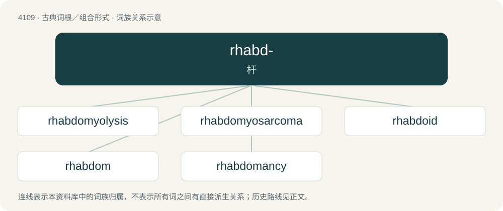

# 4120 · rhabd- — 杆

[总目录](../00_总目录_按常用程度.md)

**类型**：古典词根／组合形式　｜　**来源语言**：古希腊语

## 核心含义与来源

- 核心含义：杆
- 英文含义：rod
- 词形：rhabd-

**来源词形**：ῥάβδος (rhábdos)

## 词族图

## 单词速览（常用到不常用）

| 单词 | 音标 | 释义 |
|---|---|---|
| [rhabdomyolysis](#w-1) | 英 /ˌɹæb.dəʊ.mʌɪˈɒl.ɪs.ɪs/；美 /ˌɹæb.doʊ.maɪˈɑl.əs.ɪs/ | n. \[医\]横纹肌溶解 |
| [rhabdomyosarcoma](#w-2) | /ˈræbdəj,maiə?sɑːˈkəjmə/ | \[医\] 横纹肌肉瘤 |
| [rhabdoid](#w-3) |  | \[医\] 杆状的 |
| [rhabdom](#w-4) | /ˈræb,dɔm/ | n. \[昆\]感杆束(昆虫小眼中一杆状构造) |
| [rhabdomancy](#w-5) | 英 /ˈɹæb.dəˌmæn.si/ | n. 棍卜术 |

## 逐词详解

### 1. rhabdomyolysis

**词性**：名词　｜　**音标**：英 /ˌɹæb.dəʊ.mʌɪˈɒl.ɪs.ɪs/；美 /ˌɹæb.doʊ.maɪˈɑl.əs.ɪs/

**中文释义**：n. \[医\]横纹肌溶解

**英文义项**：The rapid disintegration of striated muscle tissue accompanied by the excretion of myoglobin in the urine.

**构词拆分**：myo- + -lysis

**词源与演化**：

From Ancient Greek ῥάβδος (rhábdos, “rod, wand”) + English myo- (“muscle”) + -lysis (“decomposition, breakdown”).

### 2. rhabdomyosarcoma

**词性**：名词　｜　**音标**：/ˈræbdəj,maiə?sɑːˈkəjmə/

**中文释义**：\[医\] 横纹肌肉瘤

**英文义项**：A cancerous tumor of skeletal muscle.

**构词拆分**：rhabdo- + myo- + sarcoma

**词源与演化**：

From rhabdo- + myo- + sarcoma.

### 3. rhabdoid

**词性**：形容词

**中文释义**：\[医\] 杆状的

**英文义项**：Shaped like a rod.

**构词拆分**：rhabdo- + -oid

**词源与演化**：

From rhabdo- + -oid.

### 4. rhabdom

**词性**：名词　｜　**音标**：/ˈræb,dɔm/

**中文释义**：n. \[昆\]感杆束(昆虫小眼中一杆状构造)

**英文义项**：Any of the rods that support each ommatidium in the compound eye of arthropods

### 5. rhabdomancy

**词性**：名词　｜　**音标**：英 /ˈɹæb.dəˌmæn.si/

**中文释义**：n. 棍卜术

**英文义项**：Divination with wands or rods, especially to use a divining rod to find things below the ground.

**构词拆分**：rhabdo- + -mancy

**词源与演化**：

From rhabdo- + -mancy, first attested in 1646. From Latin rhabdomantīa, from Ancient Greek ῥαβδομαντεία (rhabdomanteía), from ῥάβδος (rhábdos, “rod”) + μαντεία (manteía, “divination”).

## 其他候选词

- Rhabdodon
