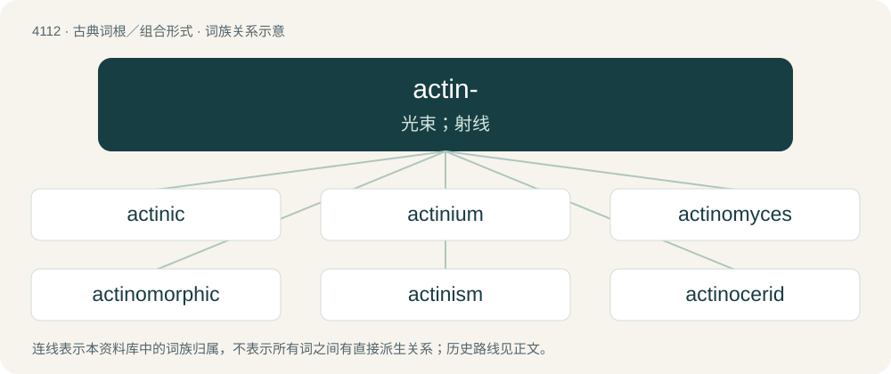

# 4123 · actin- — 光束；射线

[总目录](../00_总目录_按常用程度.md)

**类型**：古典词根／组合形式　｜　**来源语言**：古希腊语

## 核心含义与来源

- 核心含义：光束；射线
- 英文含义：beam, ray
- 词形：actin-

**来源词形**：ἀκτίς, ἀκτῖνος (aktís, aktînos)

## 词族图

## 单词速览（常用到不常用）

| 单词 | 音标 | 释义 |
|---|---|---|
| [actinic](#w-1) | /ækˈtɪn ɪk/ | a. 光化的；\[医\] 光化性的 |
| [actinium](#w-2) | /ækˈtɪniəm/ | n. 锕；\[化\] 锕Ac |
| [actinomyces](#w-3) | /,æktinəuˈmaisiːz/ | \[单复同\] n.\[微\]放线菌 |
| [actinomorphic](#w-4) | /,æktinəuˈmɔːfik/ | a. 放射状的, 辐射对称的 |
| [actinism](#w-5) | /ˈæktinizm/ | n. 光化性, 光化作用；\[化\] 射线化学 |
| [actinocerid](#w-6) |  | 【英文】Any extinct cephalopod of the order †Actinocerida |
| [actinoid](#w-7) | /ˈæktɪnɔɪd/ | a. 放射线状的；\[化\] 锕系元素; 锕系 |
| [actinomere](#w-8) | /ækˈtinəmiə/ | 放线节, 放射体节 |
| [actinometer](#w-9) | /.æktiˈnɒmitə/ | n. 光化线强度计, 日射强度表, 曝光计；\[化\] 光能测定仪; 露光计; 化学光度计 |
| [actinophryid](#w-10) |  | 【英文】Any heliozoan of the order Actinophryida |
| [actinopod](#w-11) |  | \[网络\] 肌动蛋白 |
| [actinotherapy](#w-12) | /,æktinəˈθerəpi/ | n. \[医\]射线疗法 |

## 逐词详解

### 1. actinic

**词性**：形容词　｜　**音标**：/ækˈtɪn ɪk/

**中文释义**：a. 光化的；\[医\] 光化性的

**英文义项**：Related to radiation; used most often in reference to light, especially in the ultraviolet range. / Harsh and bright, especially blindingly so.

**词源与演化**：

From Ancient Greek ἀκτίς, ἀκτῖν- (aktís, aktîn-, “ray”) + -ic.

**例句**：

> In medicine, actinic keratoses usually occur in sundamaged skin and exhibit hyperkeratosis.

该用例对应义项：Caused by extensive exposure to ultraviolet light.

### 2. actinium

**词性**：名词　｜　**音标**：/ækˈtɪniəm/

**中文释义**：n. 锕；\[化\] 锕Ac

**英文义项**：A radioactive, metallic chemical element (symbol: Ac) with an atomic number of 89; found in uranium ores. / An atom of this element.

**构词拆分**：actin- + -ium

**词源与演化**：

Borrowed from French actinium. actin- + -ium.

**例句**：

> The half life of actinium-225 is approximately 10 days.

### 3. actinomyces

**词性**：名词　｜　**音标**：/,æktinəuˈmaisiːz/

**中文释义**：\[单复同\] n.\[微\]放线菌

**英文义项**：Any bacterium (species) of the genus Actinomyces.

### 4. actinomorphic

**词性**：形容词　｜　**音标**：/,æktinəuˈmɔːfik/

**中文释义**：a. 放射状的, 辐射对称的

**英文义项**：Having its petals arranged in a radially symmetric fashion.

**构词拆分**：actino- + -morphic

**词源与演化**：

From actino- + -morphic.

### 5. actinism

**词性**：名词　｜　**音标**：/ˈæktinizm/

**中文释义**：n. 光化性, 光化作用；\[化\] 射线化学

**英文义项**：That property of electromagnetic radiation that leads to the production of photochemical effects

**构词拆分**：actin- + -ism

**词源与演化**：

From actin- + -ism.

### 6. actinocerid

**词性**：名词

**英文义项**：Any extinct cephalopod of the order †Actinocerida

**词源与演化**：

Clipping of taxonomic name Actinocerida.

### 7. actinoid

**词性**：名词　｜　**音标**：/ˈæktɪnɔɪd/

**中文释义**：a. 放射线状的；\[化\] 锕系元素; 锕系

**英文义项**：actinide

**构词拆分**：actin- + -oid

**词源与演化**：

From actin- + -oid.

### 8. actinomere

**词性**：名词　｜　**音标**：/ækˈtinəmiə/

**中文释义**：放线节, 放射体节

**英文义项**：One of the radial segments making up the body of one of the Coelenterata or similar organism

**构词拆分**：actino- + -mere

**词源与演化**：

From actino- + -mere.

### 9. actinometer

**词性**：名词　｜　**音标**：/.æktiˈnɒmitə/

**中文释义**：n. 光化线强度计, 日射强度表, 曝光计；\[化\] 光能测定仪; 露光计; 化学光度计

**英文义项**：An instrument used to measure the heating power of electromagnetic radiation, especially that of solar radiation.

**构词拆分**：actino- + -meter

**词源与演化**：

From actino- + -meter.

### 10. actinophryid

**词性**：名词

**英文义项**：Any heliozoan of the order Actinophryida

**词源与演化**：

Clipping of taxonomic name Actinophryida.

### 11. actinopod

**词性**：名词

**中文释义**：\[网络\] 肌动蛋白

**英文义项**：Any member of the variously ranked group Actinopoda of protozoa.

### 12. actinotherapy

**词性**：名词　｜　**音标**：/,æktinəˈθerəpi/

**中文释义**：n. \[医\]射线疗法

**英文义项**：The treatment of disease, especially skin disease, by exposure to ultraviolet light; radiotherapy.

**构词拆分**：actino- + therapy

**词源与演化**：

From actino- + therapy.

## 其他候选词

- actinodrome
- Actinopterygii
- actinozoa
