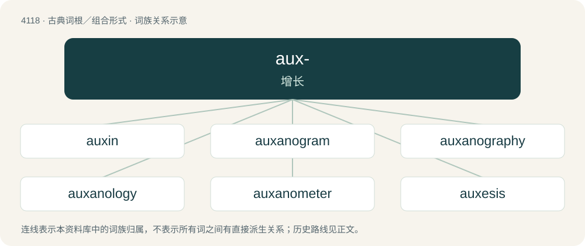

# 4131 · aux- — 增长

[总目录](../00_总目录_按常用程度.md)

**类型**：古典词根／组合形式　｜　**来源语言**：古希腊语

## 核心含义与来源

- 核心含义：增长
- 英文含义：increase
- 词形：aux-

**来源词形**：αὔξειν (aúxein), αὐξάνειν auxánein, αὔξησις (aúxēsis), αὐξητικός (auxētikós)

## 词族图

## 单词速览（常用到不常用）

| 单词 | 音标 | 释义 |
|---|---|---|
| [auxin](#w-1) | /ˈɒːksin/ | n. 植物激素；\[化\] 茁长素(植物生长素) |
| [auxanogram](#w-2) | /ɔːkˈsænə^ræm/ | (细菌)发育培养象, 生长谱 |
| [auxanography](#w-3) | /,ɔːksəˈnɔ^rəfi/ | (细菌)发育培养检查法 |
| [auxanology](#w-4) | /,ɔːksəˈnɔlədʒi/ | 生长学, 发育学 |
| [auxanometer](#w-5) | /,ɔːksəˈnɔmitə/ | n. 生长计,植物生长过程测定器 |
| [auxesis](#w-6) | /ɔːkˈsiːsis/ | n. 细胞增大性生长 |
| [auxetic](#w-7) | 英 /ɔːkˈsɛtɪk/；美 /ɔkˈsɛtɪk/ | n. 细胞增大剂；a. 细胞增大性生长的, 促进细胞增大的 |
| [auxochrome](#w-8) | /ˈɔːksəkrəum/ | n. 助色团 |
| [auxology](#w-9) | /ɔːkˈsɔːlədʒi/ | 生长学, 发育学 |
| [auxotroph](#w-10) | /ˈɔːksətrɔf/ | n. 营养缺陷型, 营养缺陷体；\[医\] 营养缺陷型 |
| [auxotrophy](#w-11) | /ɔːkˈsɔtrəfi/ | n. 营养缺陷型, 营养缺陷体 |

## 逐词详解

### 1. auxin

**词性**：名词　｜　**音标**：/ˈɒːksin/

**中文释义**：n. 植物激素；\[化\] 茁长素(植物生长素)

**英文义项**：A class of plant growth substance (often called phytohormones or plant hormones) which play an essential role in coordination of many growth and behavioral processes in the plant life cycle.

**词源与演化**：

From Ancient Greek αὐξάνω (auxánō, “to grow”) + English -in.

### 2. auxanogram

**词性**：名词　｜　**音标**：/ɔːkˈsænə^ræm/

**中文释义**：(细菌)发育培养象, 生长谱

**英文义项**：A culture of microorganisms used in auxanography.

**构词拆分**：Ancient Greek αὐξάνω (auxánō, “to grow”) + -gram

**词源与演化**：

From Ancient Greek αὐξάνω (auxánō, “to grow”) + -gram.

### 3. auxanography

**词性**：名词　｜　**音标**：/,ɔːksəˈnɔ^rəfi/

**中文释义**：(细菌)发育培养检查法

**英文义项**：The study of the effects of changes in environment on the growth of microorganisms.

**构词拆分**：Ancient Greek αὐξάνω (auxánō, “to grow”) + -graphy

**词源与演化**：

From Ancient Greek αὐξάνω (auxánō, “to grow”) + -graphy.

### 4. auxanology

**词性**：名词　｜　**音标**：/,ɔːksəˈnɔlədʒi/

**中文释义**：生长学, 发育学

**英文义项**：auxology

### 5. auxanometer

**词性**：名词　｜　**音标**：/,ɔːksəˈnɔmitə/

**中文释义**：n. 生长计,植物生长过程测定器

**英文义项**：An instrument to measure the growth of plants.

### 6. auxesis

**词性**：名词　｜　**音标**：/ɔːkˈsiːsis/

**中文释义**：n. 细胞增大性生长

**英文义项**：Overstatement, hyperbole. / Arrangement of a series in ascending order.

**词源与演化**：

From Ancient Greek αὔξησις (aúxēsis, “growth”), from αὐξάνω (auxánō, “to grow”).

### 7. auxetic

**词性**：形容词　｜　**音标**：英 /ɔːkˈsɛtɪk/；美 /ɔkˈsɛtɪk/

**中文释义**：n. 细胞增大剂；a. 细胞增大性生长的, 促进细胞增大的

**英文义项**：Having the property of counterintuitively expanding when being stretched. / Relating to auxesis

**词源与演化**：

From Ancient Greek αὐξητικός (auxētikós, “growing, promoting growth, productive”).

### 8. auxochrome

**词性**：名词　｜　**音标**：/ˈɔːksəkrəum/

**中文释义**：n. 助色团

**英文义项**：any atom or group which, when added to a chromophore, causes a bathochromic shift in its spectrum

**构词拆分**：From auxo- + -chrome.

**词源与演化**：

From auxo- + -chrome.

### 9. auxology

**词性**：名词　｜　**音标**：/ɔːkˈsɔːlədʒi/

**中文释义**：生长学, 发育学

**英文义项**：The study of growth

**构词拆分**：auxo- + -logy

**词源与演化**：

From auxo- + -logy.

### 10. auxotroph

**词性**：名词　｜　**音标**：/ˈɔːksətrɔf/

**中文释义**：n. 营养缺陷型, 营养缺陷体；\[医\] 营养缺陷型

**英文义项**：Any microorganism that has lost the ability to synthesize an organic compound required for its growth, usually as a result of mutation

**构词拆分**：auxo- + -troph

**词源与演化**：

From auxo- + -troph.

### 11. auxotrophy

**词性**：名词　｜　**音标**：/ɔːkˈsɔtrəfi/

**中文释义**：n. 营养缺陷型, 营养缺陷体

**英文义项**：The inability of a microorganism to synthesize an organic compound required for its growth, often as a result of mutation.

**构词拆分**：auxo- + -trophy

**词源与演化**：

From auxo- + -trophy.
