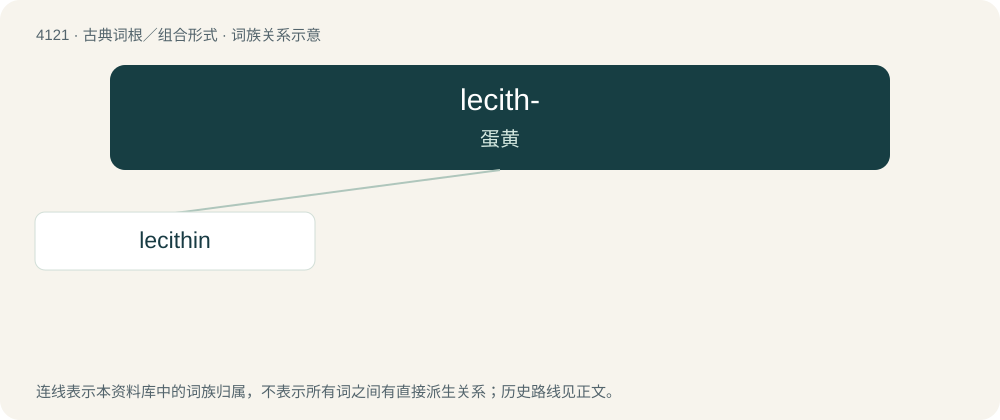

# 4133 · lecith- — 蛋黄

[总目录](../00_总目录_按常用程度.md)

**类型**：古典词根／组合形式　｜　**来源语言**：古希腊语

## 核心含义与来源

- 核心含义：蛋黄
- 英文含义：egg yolk
- 词形：lecith-

**来源词形**：λέκιθος (lékithos)

## 词族图

## 单词速览（常用到不常用）

| 单词 | 音标 | 释义 |
|---|---|---|
| [lecithin](#w-1) | /ˈlɛs.ə.θɪn/ | n. 卵磷脂；\[化\] 卵磷脂 |

## 逐词详解

### 1. lecithin

**词性**：名词　｜　**音标**：/ˈlɛs.ə.θɪn/

**中文释义**：n. 卵磷脂；\[化\] 卵磷脂

**英文义项**：The principal phospholipid in animals; it is particularly abundant in egg yolks, and is extracted commercially from soy. It is a major constituent of cell membranes, and is commonly used as a food additive (as an emulsifier).

**词源与演化**：

From French lécithine, coined in 1847 by Theodore Gobley, from Ancient Greek λέκιθος (lékithos, “egg yolk”).
