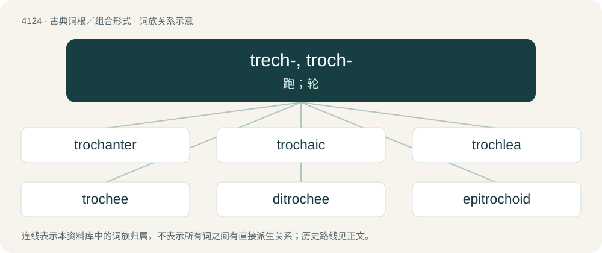

# 4136 · trech-, troch- — 跑；轮

[总目录](../00_总目录_按常用程度.md)

**类型**：古典词根／组合形式　｜　**来源语言**：古希腊语

## 核心含义与来源

- 核心含义：跑；轮
- 英文含义：run, wheel
- 词形：trech-, troch-

**来源词形**：τρέχειν (trékhein), τρεχόμενον, τρόχος (tróchos), τροχός, τροχοῦ (trochós), τρόχωσις, τροχαῖος (trochaîos), τροχαϊκός (trochaïkós), τροχοειδής

## 词族图

## 单词速览（常用到不常用）

| 单词 | 音标 | 释义 |
|---|---|---|
| [trochanter](#w-1) | 英 /trə(ʊ)ˈkæn.tə(r)/ | \[医\] 转子(解剖); 转节(昆虫) |
| [trochaic](#w-2) | 英 /tɹoʊˈkeɪ.ɪk/；美 /tɹəˈkeɪ.ɪk/ | n. 扬抑格诗句；a. 扬抑格的, 长短格的 |
| [trochlea](#w-3) | 英 /ˈtɹɒk.li.ə/；美 /ˈtɹɑk.li.ə/ | n. 滑车；\[医\] 滑车 |
| [trochee](#w-4) | 美 /ˈtɹoʊ.ki/；/ˈtɹəʊki/ | n. 扬抑格, 长短格 |
| [ditrochee](#w-5) | /daiˈtrəukiː/ | n. 【韵律学】双重长短格；双重扬抑格音步 |
| [epitrochoid](#w-6) | /,epiˈtrəukɔid/ | \[机\] 外转轴线 |
| [hypotrochoid](#w-7) | 英 /ˌhaɪ.pə(ʊ)ˈtɹəʊ.kɔɪd/；美 /ˌhaɪ.poʊˈtɹoʊ.kɔɪd/ | \[机\] 内转迹线 |
| [trochelminth](#w-8) | /ˈtrɔkl,minθ/ | n. \[动\]担轮动物(如轮虫) |
| [trochoid](#w-9) | /ˈtrəukɒid/ | n. 次摆线, 车轴关节；a. 车轴状的 |
| [trochophore](#w-10) | /ˈtrɔkə,fɔː/ | n. \[动\]担轮幼虫 |

## 逐词详解

### 1. trochanter

**词性**：名词　｜　**音标**：英 /trə(ʊ)ˈkæn.tə(r)/

**中文释义**：\[医\] 转子(解剖); 转节(昆虫)

**英文义项**：In vertebrates with legs, the end of the femur near the hip joint, not including the head or neck. / In some arthropods, the second segment of the leg, between the coxa and the femur.

**词源与演化**：

From French trochanter, from Ancient Greek τροχαντήρ (trokhantḗr).

**例句**：

> The bedridden patient had a pressure sore over the greater trochanter.

### 2. trochaic

**词性**：形容词　｜　**音标**：英 /tɹoʊˈkeɪ.ɪk/；美 /tɹəˈkeɪ.ɪk/

**中文释义**：n. 扬抑格诗句；a. 扬抑格的, 长短格的

**英文义项**：Composed of or relating to trochees, feet of one stressed syllable followed by an unstressed syllable.

**词源与演化**：

Either via the French trochaïque or directly from its etymon, the Latin trochaicus, from the Ancient Greek τροχαικός (trokhaikós), from τροχαῖος (trokhaîos), whence trochee.

### 3. trochlea

**词性**：名词　｜　**音标**：英 /ˈtɹɒk.li.ə/；美 /ˈtɹɑk.li.ə/

**中文释义**：n. 滑车；\[医\] 滑车

**英文义项**：In the elbow joint, the articular surface of the lower extremity of the humerus, grasped by the trochlear notch of the ulna. / A pulley-like cartilage through which the superior oblique muscle of the eyeball passes.

**词源与演化**：

Borrowed from Latin trochlea (“case or sheaf containing one or more pulleys, block”).

### 4. trochee

**词性**：名词　｜　**音标**：美 /ˈtɹoʊ.ki/；/ˈtɹəʊki/

**中文释义**：n. 扬抑格, 长短格

**英文义项**：A metrical foot in verse consisting of a stressed or heavy syllable followed by an unstressed or light syllable.

**词源与演化**：

Borrowed from French trochée, via Latin trochaeus from the Ancient Greek τροχαῖος (trokhaîos), derived from τρέχω (trékhō, “run”).

### 5. ditrochee

**词性**：名词　｜　**音标**：/daiˈtrəukiː/

**中文释义**：n. 【韵律学】双重长短格；双重扬抑格音步

**英文义项**：A double trochee; a metrical foot made up of two trochees.

**词源与演化**：

Latin ditrochaeus, from Ancient Greek.

### 6. epitrochoid

**词性**：名词　｜　**音标**：/,epiˈtrəukɔid/

**中文释义**：\[机\] 外转轴线

**英文义项**：A geometric curve traced by a fixed point on one circle which rotates around the perimeter of another circle. Examples include the shape of the Wankel engine

**构词拆分**：epi- + trochoid

**词源与演化**：

From epi- + trochoid.

### 7. hypotrochoid

**词性**：名词　｜　**音标**：英 /ˌhaɪ.pə(ʊ)ˈtɹəʊ.kɔɪd/；美 /ˌhaɪ.poʊˈtɹoʊ.kɔɪd/

**中文释义**：\[机\] 内转迹线

**英文义项**：A geometric curve traced by a fixed point on the radius line outside one circle which rotates inside the perimeter of another circle.

**构词拆分**：hypo- + trochoid

**词源与演化**：

From hypo- + trochoid.

### 8. trochelminth

**词性**：名词　｜　**音标**：/ˈtrɔkl,minθ/

**中文释义**：n. \[动\]担轮动物(如轮虫)

**英文义项**：Any member of the Trochelminthes.

### 9. trochoid

**词性**：名词　｜　**音标**：/ˈtrəukɒid/

**中文释义**：n. 次摆线, 车轴关节；a. 车轴状的

**英文义项**：The curve traced by a point on a circle as it rolls along a straight line / An organism or fossil with a trochoid shell (especially one in the gastropod family Trochidae), or the shell itself.

**词源与演化**：

From Ancient Greek τροχοειδής (trokhoeidḗs), from τροχός (trokhós, “wheel”) + εἶδος (eîdos, “form, image”).

### 10. trochophore

**词性**：名词　｜　**音标**：/ˈtrɔkə,fɔː/

**中文释义**：n. \[动\]担轮幼虫

**英文义项**：The free-swimming larva of some invertebrates that have a circlet of cilia

**构词拆分**：trocho- + -phore

**词源与演化**：

From trocho- + -phore.
