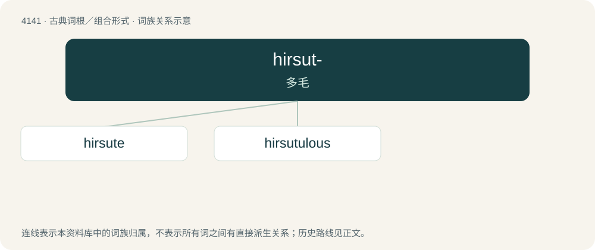

# 4150 · hirsut- — 多毛

[总目录](../00_总目录_按常用程度.md)

**类型**：古典词根／组合形式　｜　**来源语言**：拉丁语

## 核心含义与来源

- 核心含义：多毛
- 英文含义：hairy
- 词形：hirsut-

**来源词形**：hirtus, hirsutus

## 词族图

## 单词速览（常用到不常用）

| 单词 | 音标 | 释义 |
|---|---|---|
| [hirsute](#w-1) | 英 /həːˈsjuːt/；美 /hɚˈsut/ | a. 多毛的, 有粗毛的；\[医\] 多毛的 |
| [hirsutulous](#w-2) | /həːˈsjuːtjələs/ | a. 毛发稀疏的 |

## 逐词详解

### 1. hirsute

**词性**：形容词　｜　**音标**：英 /həːˈsjuːt/；美 /hɚˈsut/

**中文释义**：a. 多毛的, 有粗毛的；\[医\] 多毛的

**英文义项**：Covered in hair or bristles; hairy.

**词源与演化**：

From Latin hirsūtus (“shaggy, hairy”).

### 2. hirsutulous

**词性**：形容词　｜　**音标**：/həːˈsjuːtjələs/

**中文释义**：a. 毛发稀疏的

**英文义项**：Having small or sparse hairs.
