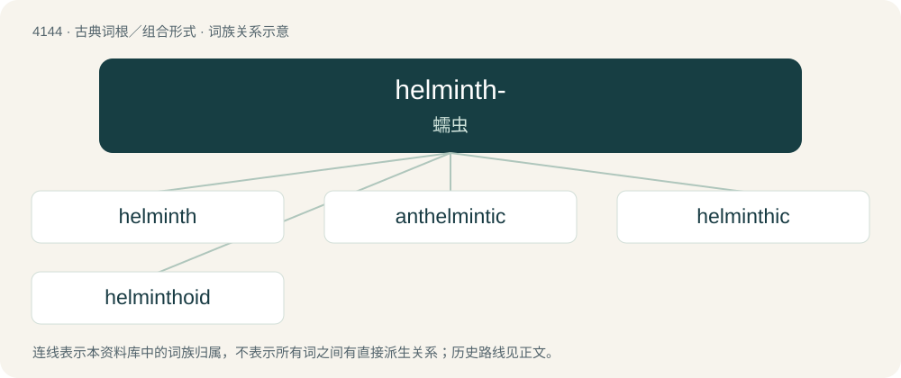

# 4155 · helminth- — 蠕虫

[总目录](../00_总目录_按常用程度.md)

**类型**：古典词根／组合形式　｜　**来源语言**：古希腊语

## 核心含义与来源

- 核心含义：蠕虫
- 英文含义：worm
- 词形：helminth-

**来源词形**：ἕλμινς, ἕλμινθος (hélmins, hélminthos)

## 词族图

## 单词速览（常用到不常用）

| 单词 | 音标 | 释义 |
|---|---|---|
| [helminth](#w-1) | /ˈhɛl.mɪnθ/ | n. 寄生虫, 蠕虫；\[医\] 蠕虫, 肠虫 |
| [anthelmintic](#w-2) | 英 /ænθɛlˈmɪntɪk/；美 /ænt.hɛlˈmɪntɪk/ | a. 驱肠虫的；n. 驱肠虫剂 |
| [helminthic](#w-3) | /helˈminθik/ | a. 肠虫的, 驱虫的；n. 驱虫剂, 杀虫药 |
| [helminthoid](#w-4) | /helˈminθɔid/ | a. 蠕虫状的,肠虫状的 |

## 逐词详解

### 1. helminth

**词性**：名词　｜　**音标**：/ˈhɛl.mɪnθ/

**中文释义**：n. 寄生虫, 蠕虫；\[医\] 蠕虫, 肠虫

**英文义项**：A parasitic worm; a fluke, tapeworm, or nematode.

**词源与演化**：

From Ancient Greek ἕλμινς (hélmins, “intestinal worm”).

### 2. anthelmintic

**词性**：形容词　｜　**音标**：英 /ænθɛlˈmɪntɪk/；美 /ænt.hɛlˈmɪntɪk/

**中文释义**：a. 驱肠虫的；n. 驱肠虫剂

**英文义项**：Destructive to parasitic worms.

**构词拆分**：ant-&gt; + helminth + -ic；ant- + helminth + -ic

**词源与演化**：

From ant- + helminth + -ic; for some speakers, the prefix's t- and helminth's initial h- have become /θ/ while the final th of helminth has become t by dissimilation.

**例句**：

> Research is progressing well on finding native plants with anthelmintic properties.

该用例对应义项：Destructive to parasitic worms.

### 3. helminthic

**词性**：形容词　｜　**音标**：/helˈminθik/

**中文释义**：a. 肠虫的, 驱虫的；n. 驱虫剂, 杀虫药

**英文义项**：Of or pertaining to worms; used especially of parasitic worms. / Causing the expulsion of intestinal worms.

**构词拆分**：helminth + -ic

**词源与演化**：

From helminth + -ic.

### 4. helminthoid

**词性**：形容词　｜　**音标**：/helˈminθɔid/

**中文释义**：a. 蠕虫状的,肠虫状的

**英文义项**：vermicular; wormlike

**构词拆分**：helminth + -oid

**词源与演化**：

From helminth + -oid.

## 其他候选词

- antihelminthic
