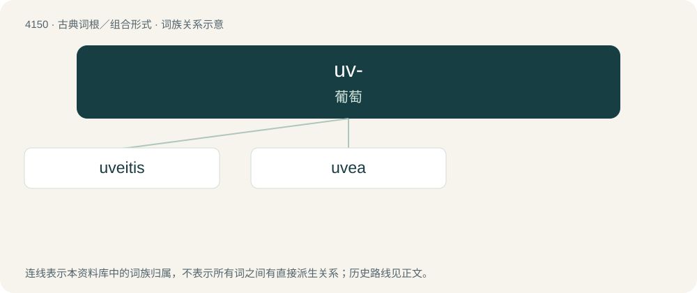

# 4162 · uv- — 葡萄

[总目录](../00_总目录_按常用程度.md)

**类型**：古典词根／组合形式　｜　**来源语言**：拉丁语

## 核心含义与来源

- 核心含义：葡萄
- 英文含义：grape
- 词形：uv-

**来源词形**：uva

## 词族图

## 单词速览（常用到不常用）

| 单词 | 音标 | 释义 |
|---|---|---|
| [uveitis](#w-1) | /,juːviˈaitis/ | n. \[医\]眼色素层炎,葡萄膜炎 |
| [uvea](#w-2) | 英 /ˈjuːvɪə/；美 /ˈjuvɪə/ | n. \[解\]眼色素层,葡萄膜 |

## 逐词详解

### 1. uveitis

**词性**：名词　｜　**音标**：/,juːviˈaitis/

**中文释义**：n. \[医\]眼色素层炎,葡萄膜炎

**英文义项**：Inflammation of the uvea.

**构词拆分**：uvea + -itis

**词源与演化**：

From uvea + -itis.

**例句**：

> Intermediate uveitis is often characterized by the sudden presence of floaters.

### 2. uvea

**词性**：名词　｜　**音标**：英 /ˈjuːvɪə/；美 /ˈjuvɪə/

**中文释义**：n. \[解\]眼色素层,葡萄膜

**英文义项**：The middle of the three concentric layers that make up the eye; it is pigmented and vascular, and comprises the choroid, the ciliary body, and the iris.

**词源与演化**：

From Medieval Latin ūvea (“grape-like”), from Latin ūva (“grape”) + -ea, partial calque of Ancient Greek ῥαγοειδής χιτών (rhagoeidḗs khitṓn, “\[covering\] like a grape”), from ῥάξ (rháx, “grape”).
